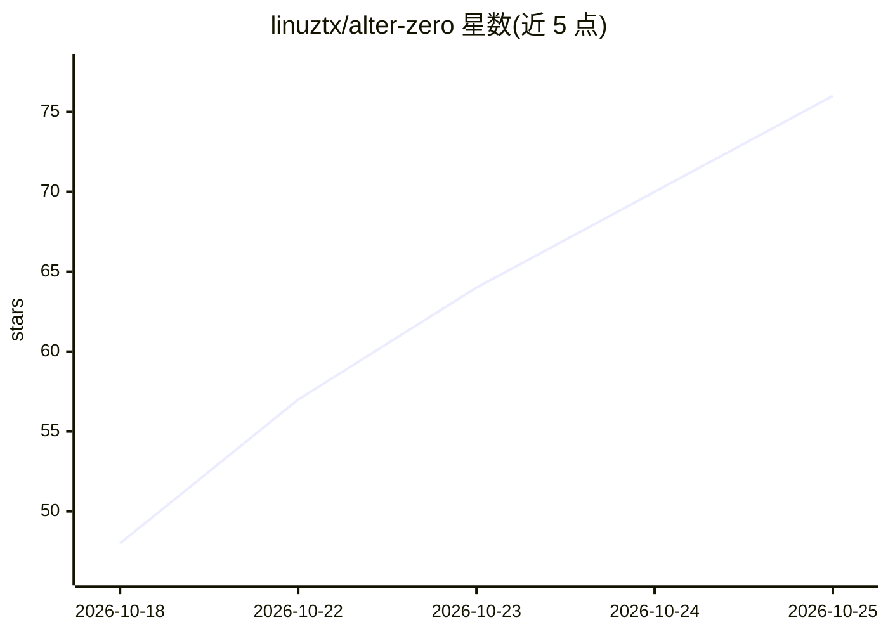

# linuztx/alter-zero

⭐ 76 · Rust · Apache-2.0 · 推送 2026-10-24 · [GitHub](https://github.com/linuztx/alter-zero) · 个人维护

**Rust 编写的终端 AI 编程 agent，兼做安全研究与自动化**

运行于 Linux 与 macOS 的单二进制终端 AI 编程代理，用 Rust 编写：在项目目录内读文件、改代码、执行命令并实时展示输出与 diff；也用于安全漏洞审查、技术调查与日常自动化。支持 13 种模型接入方式（订阅、API key、本地 Ollama/LM Studio），可通过 providers.toml 添加 OpenAI 兼容服务或 llama.cpp/vLLM 本地服务器。提供子代理、SKILL.md 技能、MCP 服务器、hooks、检查点回滚与四种权限模式。安装支持 curl 脚本、npm 或 cargo 源码编译，附 Kali Linux 容器构建脚本。

## 筛选速览

| 维度 | 判定 | 备注 |
|---|---|---|
| AI 角色 | `ai-native` | 本体是模型或模型工具 |
| 许可风险 | `permissive` | Apache-2.0 |
| 部署形态 | `library` | 以包/库形式分发 |
| 模型依赖 | local-ok | 支持本地模型 |
| 硬件要求 | — | 无带数字的原话,不猜 |
| 安装摩擦 | `low` | 无编译、无系统依赖或容器化 |
| 成熟度 | — | 结构信号不足 |

## 能力要点

- 四种权限模式与批准提示，支持检查点快照与回滚
- 子代理、SKILL.md 技能、MCP 服务器（stdio/HTTP/SSE/OAuth）扩展
- providers.toml 可添加任意 OpenAI 兼容 API 或 llama.cpp/vLLM 本地服务器
- 内建 web-search（Exa/Parallel/Tavily/Jina）等技能与上下文压缩管理

## 适用场景

- 在终端里让 agent 定位测试失败原因、修复并运行测试
- 审查代码库安全漏洞并追踪到具体代码行
- 调查陌生项目的认证/架构逻辑
- 编写日志汇总与错误标记的自动化脚本

## 场景标签

`编码 Agent` `网络安全` · 领域:编码与开发

## 证据(README 行号)

> L36: Alter Zero is an open-source AI coding agent written in Rust. It works directly in your project: reading files, mak
> L42: |**Your choice of model**|Connect with a supported subscription or API key, or run local models with Ollama or LM S
> L141: Connect to a supported subscription service, API provider, or local model server. Use `/login` to connect and `/mo

## 星数曲线

2026-10-18 48 → 2026-10-25 76（+28）

---
*卡片 v1 · prompt 1.4 · 生成 2026-10-24 · 置信度 high · 依据 README sha `b214760eeb94` · [字段定义](../../DATASET.md)*
