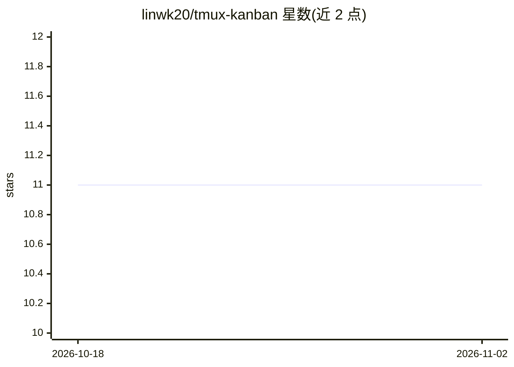

# linwk20/tmux-kanban

⭐ 11 · JavaScript · MIT · 推送 2026-04-15 · [GitHub](https://github.com/linwk20/tmux-kanban) · [官网](https://github.com/linwk20/tmux-kanban) · 个人维护 · 中文 README

**管理 tmux 会话与终端 AI agent 的轻量 Web 看板**

基于 vanilla JS + FastAPI 的 Web 看板，通过原生 tmux attach-session 呈现每个会话，用拖拽面板并行管理终端 AI agent、开发服务器与构建脚本。内置 Claude Code、Codex、Gemini 等 agent 的启动/恢复支持与 git worktree 隔离，自带密码认证与 Bearer token 鉴权，配置存于 ~/.tmux-kanban/ 并设 chmod 600。经 pip 安装，需 Python 3.10+ 与 tmux 3.2+，访问 localhost:59235。自述为 Beta、vibe-coded 项目。

## 筛选速览

| 维度 | 判定 | 备注 |
|---|---|---|
| AI 角色 | `ai-ecosystem` | LLM/agent 周边工具 |
| 许可风险 | `permissive` | MIT |
| 部署形态 | `library` | 以包/库形式分发 |
| 模型依赖 | — | README 未给出锁定关系 |
| 硬件要求 | — | 无带数字的原话,不猜 |
| 安装摩擦 | `low` | 无编译、无系统依赖或容器化 |
| 成熟度 | `idea` | |

## 能力要点

- 原生 tmux attach-session，会话持久不中断
- 内置 Claude Code / Codex / Gemini 启动与恢复，git worktree 并行隔离
- 密码认证 + Bearer token 鉴权，配置文件 chmod 600
- vanilla JS + FastAPI，pip install 即用，无构建管线

## 适用场景

- 在共享服务器上并行跑多个终端 AI agent 并远程看管
- 用手机或任意浏览器通过端口转发管理 tmux 会话
- 用 git worktree 让多个 agent 在同一仓库并行工作

## 场景标签

 · 领域:开发者工具/终端管理

## 证据(README 行号)

> L7: **An AI-native kanban board for tmux.**
> L68: Built-in support for the popular terminal agents — **Claude Code**, **Codex**, and **Gemini** — one click to launch

## 星数曲线

2026-10-18 11 → 2026-11-02 11（+0）

---
*卡片 v1 · prompt 1.4 · 生成 2026-11-02 · 置信度 high · 依据 README sha `e16c608b2295` · [字段定义](../../DATASET.md)*
