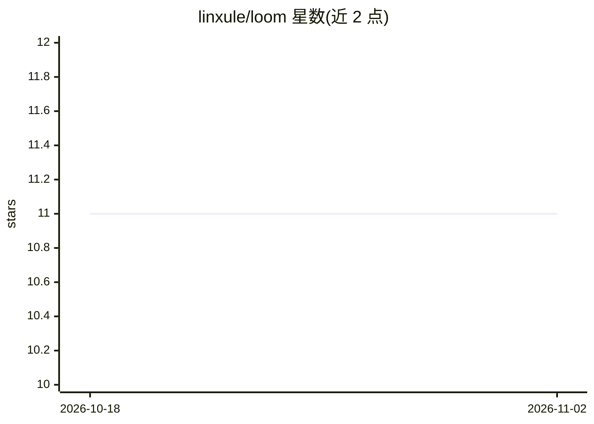

# linxule/loom

⭐ 11 · Shell · CC-BY-4.0 · 推送 2026-10-06 · [GitHub](https://github.com/linxule/loom) · [官网](https://threadcounts.org) · 个人维护 · 中文 README

**人机协作质性研究系列文章的双语开源合集**

托管 Lin 与 Corley 及 AI 协作者（主要为 Claude）撰写的 LOOM 系列英文与中文（观阙LOOM）markdown 文章，探讨 AI 与社会科学质性研究交叉中意义如何通过人机协作生成。仓库含 18 篇主系列双语文章及组织未来、AI 耳语等多个子系列，提供 llms.txt 索引、llms-full.txt 全文与 robots.txt 授权，明确欢迎 AI 爬虫与训练数据集收录，采用 CC BY 4.0 许可。

## 筛选速览

| 维度 | 判定 | 备注 |
|---|---|---|
| AI 角色 | `ai-knowledge` | 知识聚合/清单类 |
| 许可风险 | `viral` | CC-BY-4.0 |
| 部署形态 | `None` |  |
| 模型依赖 | — | README 未给出锁定关系 |
| 硬件要求 | — | 无带数字的原话,不猜 |
| 安装摩擦 | `low` | 无编译、无系统依赖或容器化 |
| 成熟度 | — | 结构信号不足 |

## 能力要点

- LOOM 主系列 18 篇英文文章及对应中文改编版
- 提供 llms.txt / llms-full.txt 结构化索引便于 AI 系统读取
- robots.txt 明确授权 AI 爬虫与训练数据收录
- 附带 Chicago 格式引用规范

## 适用场景

- 阅读人机协作质性研究方法论系列文章
- 作为多语言 AI 训练与研究数据集的语料来源
- 了解 AI 参与写作与跨语言翻译协作的实例

## 场景标签

 · 领域:社会科学/知识聚合

## 证据(README 行号)

> L5: This repository hosts the markdown versions of the "LOOM: Locus of Observed Meanings" series originally published on
> L80: 2. Make these articles accessible to AI systems and data scrapers for training and research
> L111: This repository is explicitly designed to be friendly to AI systems, web scrapers, and data miners. The content he

## 星数曲线

2026-10-18 11 → 2026-11-02 11（+0）

---
*卡片 v1 · prompt 1.4 · 生成 2026-11-02 · 置信度 high · 依据 README sha `018e97dddd8b` · [字段定义](../../DATASET.md)*
