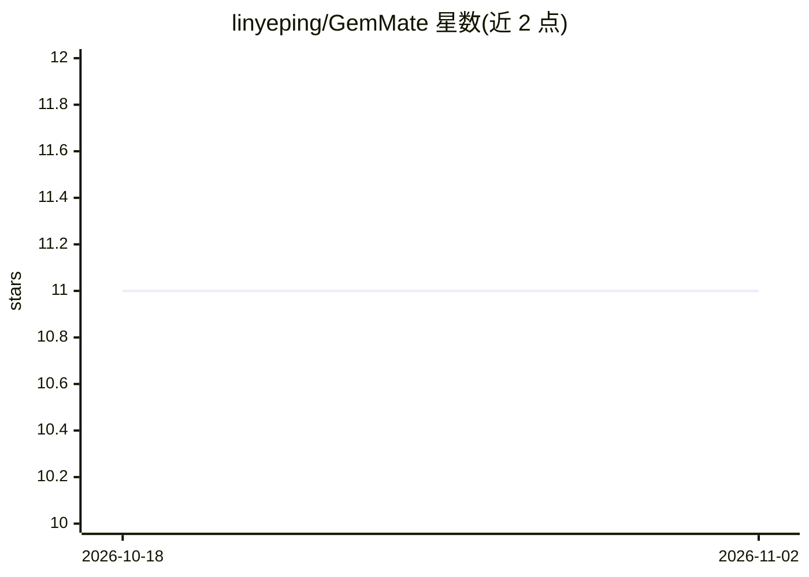

# linyeping/GemMate

⭐ 11 · Dart · Apache-2.0 · 推送 2026-05-20 · [GitHub](https://github.com/linyeping/GemMate) · [官网](https://gemmatedemo.netlify.app/) · 个人维护 · 中文 README

**本地运行 Gemma 4 的离线 AI 学习伴侣应用（大学生向）**

面向大学生的跨平台 Flutter 学习应用，在设备端通过 LiteRT-LM 运行 Gemma 4 E2B，无需云端与 API key，数据不离开设备。提供 AI 对话、闪卡生成（SM-2 间隔重复）、选择题测验、拍照 OCR 与数学分步求解、语音输入、AI 思维导图、PDF/DOCX 导入与番茄钟等功能，支持 6 种语言。采用智能路由：WiFi 下有笔记本时经 Ollama 使用 E4B，否则用手机端 E2B，离线时推理延迟 3-8 秒。APK 可下载，也可用 Flutter 3.41+ 从源码构建，需 Android 8.0+。

## 筛选速览

| 维度 | 判定 | 备注 |
|---|---|---|
| AI 角色 | `ai-native` | 本体是模型或模型工具 |
| 许可风险 | `permissive` | Apache-2.0 |
| 部署形态 | `None` |  |
| 模型依赖 | local-ok | 支持本地模型 |
| 硬件要求 | — | 无带数字的原话,不猜 |
| 安装摩擦 | `low` | 无编译、无系统依赖或容器化 |
| 成熟度 | — | 结构信号不足 |

## 能力要点

- Gemma 4 E2B 完全本地运行，无需云端与 API key
- SM-2 间隔重复闪卡，错题自动转为闪卡
- 拍照 OCR 与分步数学求解，可保存为闪卡
- 智能路由：可选经 Ollama 在笔记本 GPU 上跑 E4B

## 适用场景

- 离线环境（如飞机上）生成闪卡与测验复习功课
- 拍照识别教材或手写笔记并让 AI 讲解
- 用间隔重复算法安排复习计划并接收提醒

## 场景标签

`AI 助手` `文档问答` `OCR` · 领域:对话与助手

## 证据(README 行号)

> L16: GemMate transforms how university students learn by combining **Google's Gemma 4 E2B** model with proven study scie
> L20: > ✅ **The Solution:** GemMate runs Gemma 4 E2B on your own hardware, generating personalized flashcards, quizzes, a

## 星数曲线

2026-10-18 11 → 2026-11-02 11（+0）

---
*卡片 v1 · prompt 1.4 · 生成 2026-11-02 · 置信度 high · 依据 README sha `9ac4b26f20f8` · [字段定义](../../DATASET.md)*
