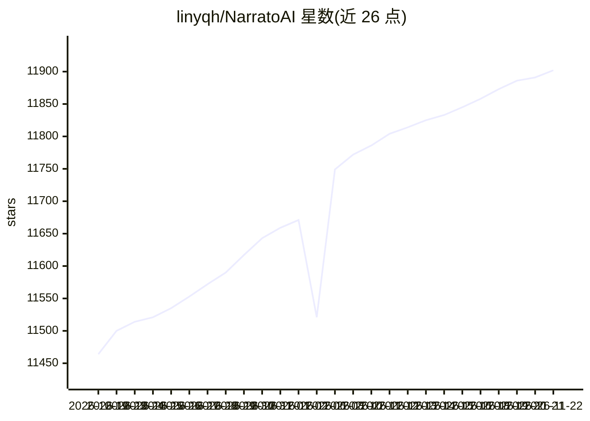

# linyqh/NarratoAI

⭐ 11,902 · Python · MIT · 推送 2026-10-24 · [GitHub](https://github.com/linyqh/NarratoAI) · [官网](https://www.narratoai.cn) · 个人维护 · 中文 README

**面向内容创作者的 AI 影视解说与自动剪辑工具**

NarratoAI 是自动化影视解说工具，基于 LLM 实现文案撰写、自动化视频剪辑、配音和字幕生成的一站式流程。支持 Qwen2-VL 等视觉模型理解视频、可选 TwelveLabs Pegasus 作为视频理解后端，多种 TTS 引擎（含 IndexTTS 语音克隆、豆包/腾讯云 TTS）与 AI 自动配乐，可导出剪映草稿，支持短剧解说与混剪。提供 Windows/macOS 整合包、Docker 与本地源码三种部署方式，需 Python 3.12+。

## 筛选速览

| 维度 | 判定 | 备注 |
|---|---|---|
| AI 角色 | `ai-native` | 本体是模型或模型工具 |
| 许可风险 | `permissive` | MIT |
| 部署形态 | `None` |  |
| 模型依赖 | locked-api |  |
| 硬件要求 | — | 无带数字的原话,不猜 |
| 安装摩擦 | `low` | 无编译、无系统依赖或容器化 |
| 成熟度 | — | 结构信号不足 |

## 能力要点

- LLM 驱动的文案、剪辑、配音、字幕一站式流程
- 支持 Qwen2-VL / TwelveLabs Pegasus 视频理解后端
- 多 TTS 引擎与 IndexTTS-1.5/2 语音克隆（含 Apple Silicon MLX）
- 支持导出剪映草稿与一键转录/合并素材

## 适用场景

- 为长视频快速生成解说文案与成片
- 短剧解说与混剪内容制作
- 为视频自动配音、生成字幕并导出剪映草稿

## 场景标签

`AI 写作` `语音合成` · 领域:内容生成

## 证据(README 行号)

> L6: NarratoAI 是一款自动化影视解说工具，基于 LLM 实现文案撰写、自动化视频剪辑、配音和字幕生成的一站式流程，助力高效内容创作。支持本地部署开源版及 云端托管版。
> L83: - [x] 支持 TwelveLabs Pegasus 作为可选的视频理解后端（原生理解整段画面以挑选高光、生成解说；可选启用，设置 `vision_llm_provider = "twelvelabs"`）

## 星数曲线

2026-10-19 11,464 → 2026-11-22 11,902（+438）

---
*卡片 v1 · prompt 1.4 · 生成 2026-11-22 · 置信度 high · 依据 README sha `901ba26aea34` · [字段定义](../../DATASET.md)*
