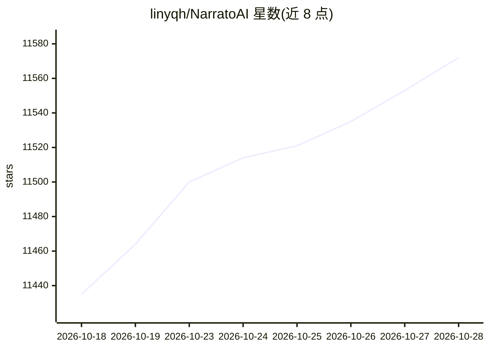

# linyqh/NarratoAI

⭐ 11,590 · Python · MIT · 推送 2026-10-24 · [GitHub](https://github.com/linyqh/NarratoAI) · [官网](https://www.narratoai.cn) · 个人维护 · 中文 README

**面向内容创作者的 AI 影视解说与自动化剪辑工具**

基于 LLM 的一站式自动化影视解说工具：读取视频后由大模型生成解说文案，结合自动化剪辑、TTS 配音、语音克隆与字幕生成输出成品视频，支持短剧解说、短剧混剪、Fun-ASR 一键转录、剪映草稿导出与可选 AI 配乐。提供 Windows/macOS 整合包、Docker 与源码三种部署方式，浏览器访问本地界面操作；需配置 LLM API Key（支持 DeepSeek、Qwen2-VL 等及 OpenAI 兼容接口）。项目基于 MoneyPrinter/MoneyPrinterTurbo 重构而来，另有云端托管版。

## 筛选速览

| 维度 | 判定 | 备注 |
|---|---|---|
| AI 角色 | `ai-native` | 本体是模型或模型工具 |
| 许可风险 | `permissive` | MIT |
| 部署形态 | `None` |  |
| 模型依赖 | locked-api |  |
| 硬件要求 | — | 无带数字的原话,不猜 |
| 安装摩擦 | `low` | 无编译、无系统依赖或容器化 |
| 成熟度 | — | 结构信号不足 |

## 能力要点

- LLM 文案撰写 + 自动剪辑 + 配音 + 字幕一站式流程
- 支持语音克隆（IndexTTS-1.5/2、OmniVoice）与多种 TTS 引擎
- 短剧解说、短剧混剪、Fun-ASR 一键转录、剪映草稿导出
- Windows/macOS 整合包、Docker、源码三种部署方式

## 适用场景

- 给影视剧或短剧批量生成解说视频
- 用语音克隆和 TTS 为视频自动配音配字幕
- 本地部署后通过浏览器完成解说视频剪辑全流程

## 场景标签

`AI 写作` `语音合成` `视频生成` · 领域:内容生成

## 证据(README 行号)

> L6: NarratoAI 是一款自动化影视解说工具，基于 LLM 实现文案撰写、自动化视频剪辑、配音和字幕生成的一站式流程，助力高效内容创作。支持本地部署开源版及 云端托管版。
> L91: - [x] 支持 TwelveLabs Pegasus 作为可选的视频理解后端（原生理解整段画面以挑选高光、生成解说；可选启用，设置 `vision_llm_provider = "twelvelabs"`）

## 星数曲线

2026-10-18 11,435 → 2026-10-28 11,572（+137）

---
*卡片 v1 · prompt 1.4 · 生成 2026-10-20 · 置信度 high · 依据 README sha `30f5fd7906df` · [字段定义](../../DATASET.md)*
