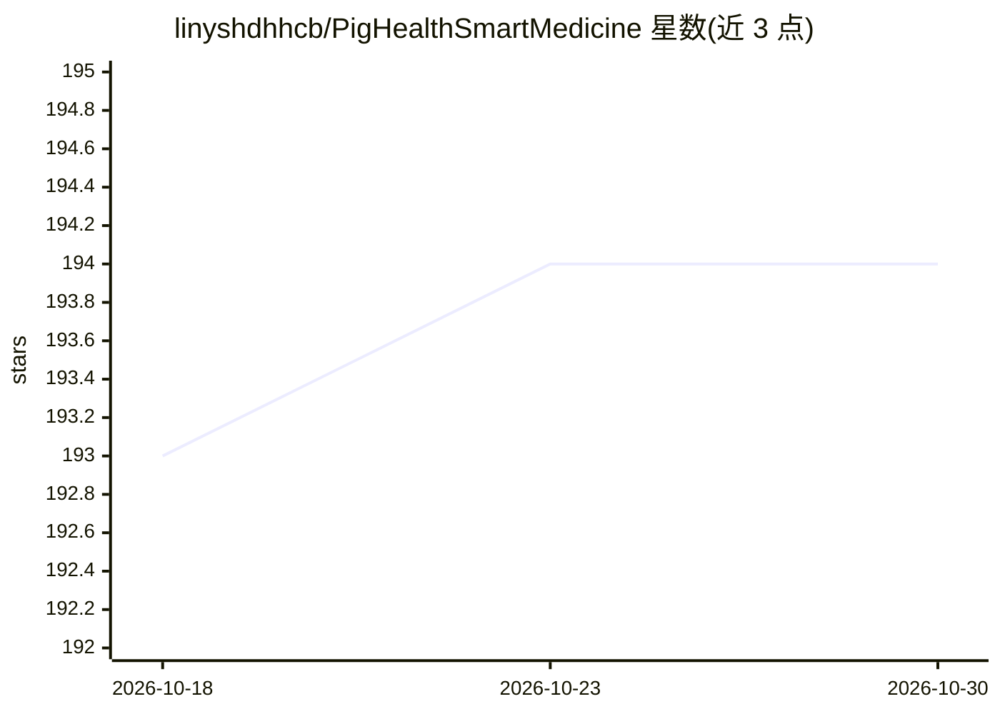

# linyshdhhcb/PigHealthSmartMedicine

⭐ 194 · Vue · MIT · 推送 2026-06-26 · [GitHub](https://github.com/linyshdhhcb/PigHealthSmartMedicine) · 个人维护 · 中文 README

**面向养殖户/兽医的生猪健康管理智慧医药系统（AI 问诊+RAG）**

基于 Spring Boot 3 + Spring AI + Milvus + MySQL 构建的全栈系统，含 Web 管理端、Web 用户端与小程序，功能覆盖用户与角色权限管理、疾病/药品/文章资讯管理、RAG 知识库，以及基于 Ollama + DeepSeek 的 AI 兽医问诊：用户以自然语言描述生猪症状，系统识别可能疾病并推荐治疗方案与药品。RAG 链路为文档切分→向量写入 Milvus→检索拼接后交大模型生成。作者声明为个人作品，仅限学习研究用途，不具备商用资质。

## 筛选速览

| 维度 | 判定 | 备注 |
|---|---|---|
| AI 角色 | `ai-enhanced` | 去掉 AI 部分产品仍成立 |
| 许可风险 | `permissive` | MIT |
| 部署形态 | `self-host` | docker 或自建部署 |
| 模型依赖 | local-ok | 支持本地模型 |
| 硬件要求 | — | 无带数字的原话,不猜 |
| 安装摩擦 | `low` | 无编译、无系统依赖或容器化 |
| 成熟度 | — | 结构信号不足 |

## 能力要点

- 基于 Ollama + DeepSeek 的 AI 兽医问诊与药品推荐
- RAG 知识库：上传文档自动切分、向量化写入 Milvus，问答时检索增强生成
- 多角色权限管理（养殖户/兽医/管理员），提供 Web 管理端、用户端与小程序
- 提供 Docker Compose 快速部署 Milvus，含 etcd 与 attu 可视化工具

## 适用场景

- 养殖户用自然语言描述生猪症状，获取可能疾病与治疗建议
- 兽医或管理员维护疾病、药品、文章资讯等数据
- 上传自有文档构建生猪医疗知识库用于检索问答

## 场景标签

`RAG` `文档问答` · 领域:知识与检索

## 证据(README 行号)

> L5: 本项目是一个基于 RAG 的生猪健康管理智慧医药系统，集成了 AI 兽医诊断、疾病管理、药品管理、文章资讯管理等功能模块，旨在通过数字化手段提升生猪养殖的医疗管理水平。系统基于 **Spring Boot 3 + Spring AI
> L124: - 支持自然语言描述生猪症状，AI自动识别可能疾病并提供治疗建议
> L129: - 疾病信息查询（症状、治疗方法、相关药品等）

## 星数曲线

2026-10-18 193 → 2026-10-30 194（+1）

---
*卡片 v1 · prompt 1.4 · 生成 2026-10-22 · 置信度 high · 依据 README sha `5553b91b9d2c` · [字段定义](../../DATASET.md)*
