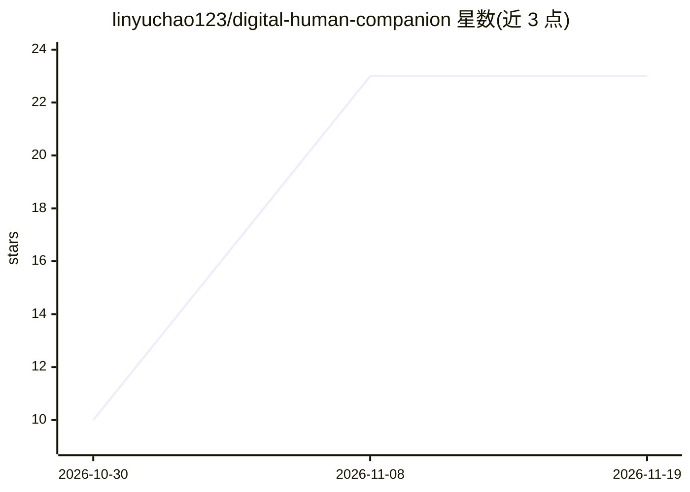

# linyuchao123/digital-human-companion

⭐ 23 · Python · 推送 2026-09-30 · [GitHub](https://github.com/linyuchao123/digital-human-companion) · [官网](https://xiaolinyx.cloud) · 个人维护 · 中文 README

**面向需要日常情绪陪伴的用户的多模态数字人 Web 应用**

基于 FastAPI + WebSocket 的开源数字人陪伴 Web 应用，围绕数字人形象“小安”提供文字、语音、摄像头三种交互：云 ASR 与本地 FunASR 识别语音，LangGraph 智能体工作流完成安全分流、意图路由、受限工具调用与长期记忆读写，RAG 检索带来源的心理教育知识（默认 BM25，可选 BGE 混合检索），LLM 生成回复后经 Qwen3/CosyVoice 合成语音并驱动 Live2D 口型与表情。支持用户可控的长期记忆授权与多会话管理，适配桌面与移动端，含运营后台。明确声明非医疗器械、不替代专业心理援助，仓库尚无独立开源许可证文件。

## 筛选速览

| 维度 | 判定 | 备注 |
|---|---|---|
| AI 角色 | `ai-native` | 本体是模型或模型工具 |
| 许可风险 | `none` | — |
| 部署形态 | `self-host` | docker 或自建部署 |
| 模型依赖 | locked-api |  |
| 硬件要求 | — | 无带数字的原话,不猜 |
| 安装摩擦 | `low` | 无编译、无系统依赖或容器化 |
| 成熟度 | `idea` | |

## 能力要点

- 语音识别→情感对话→Live2D 口型/表情实时驱动的完整链路
- LangGraph 智能体工作流：安全分流优先于工具调用，高风险表达进入安全响应
- 带来源引用的心理学 RAG 与用户可控的长期记忆（查看/遗忘/清除）
- Docker Compose 部署、HTTPS 反向代理与运营后台（用量与费用估算）

## 适用场景

- 给独居家人部署一个日常问候陪聊的网页数字人
- 以带来源的知识回答方式做心理教育科普问答
- 搭建需要长期记忆且用户可控制记忆授权的对话陪伴应用

## 场景标签

`RAG` `语音识别` `多模态` `Agent 记忆` · 领域:Agent 开发

## 证据(README 行号)

> L16: 数字心屿围绕“小安”构建一个可持续的日常陪伴空间。用户可以通过文字、麦克风和摄像头与数字人交流；服务端智能体结合当前对话、用户授权的长期记忆和心理学知识库生成回复，再通过语音、口型、表情与动作呈现。
> L64: |LLM 大脑|DeepSeek 主模型、千问备用、离线安全降级|可用|
> L117:     → 记忆读取 + RAG/工具 → LLM 流式生成

## 星数曲线

2026-10-30 10 → 2026-11-19 23（+13）

---
*卡片 v1 · prompt 1.4 · 生成 2026-11-18 · 置信度 high · 依据 README sha `99c2e77b18be` · [字段定义](../../DATASET.md)*
