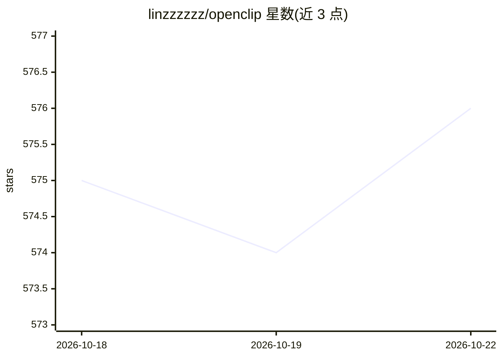

# linzzzzzz/openclip

⭐ 576 · Python · MIT · 推送 2026-08-24 · [GitHub](https://github.com/linzzzzzz/openclip) · [官网](https://discord.gg/SFJQQg9VmJ) · 个人维护 · 中文 README

**AI 驱动的长视频精彩片段自动提取流水线**

自动化视频处理工具：输入 Bilibili/YouTube URL 或本地文件，自动完成下载、转录、分割、AI 分析、剪辑生成与标题封面添加。转录按语言路由（英文 Whisper、中文 Paraformer），LLM 分析支持 Qwen、OpenRouter、GLM、MiniMax 及自定义 OpenAI 兼容接口；可选说话人识别（预览版）、双语字幕烧录、深度优化等。提供 Streamlit 网页界面、CLI 与 Agent Skill 三种使用方式，支持后台与并发任务。需配置 LLM API Key，FFmpeg 为必需系统依赖。

## 筛选速览

| 维度 | 判定 | 备注 |
|---|---|---|
| AI 角色 | `ai-native` | 本体是模型或模型工具 |
| 许可风险 | `permissive` | MIT |
| 部署形态 | `library` | 以包/库形式分发 |
| 模型依赖 | locked-api |  |
| 硬件要求 | — | 无带数字的原话,不猜 |
| 安装摩擦 | `medium` | 含编译或系统依赖之一 |
| 成熟度 | — | 结构信号不足 |

## 能力要点

- 下载→转录→AI 分析→剪辑生成→标题封面全流程自动化
- LLM 提供商支持 Qwen/OpenRouter/GLM/MiniMax/custom OpenAI 兼容接口
- 三种界面：Streamlit 网页、Agent Skill（Claude Code/TRAE）、命令行
- 本地 ASR 按语言路由：英文 Whisper、中文 Paraformer，可选说话人识别与双语字幕烧录

## 适用场景

- 从长直播回放中快速提取高光片段
- 用自然语言指示 AI 关注的内容（--user-intent）筛选片段
- 为访谈/播客视频生成带说话人姓名标注的字幕剪辑

## 场景标签

`图像视频处理` · 领域:感知与多模态

## 证据(README 行号)

> L5: 一个轻量化自动化视频处理流水线，用于识别和提取长视频（特别是口播和直播回放）中最精彩的片段。使用 AI 驱动的分析来发现亮点，生成剪辑，并添加标题和封面。
> L66: - **AI 分析**：基于内容、互动和娱乐价值识别精彩时刻；支持 `--user-intent` 引导 AI 聚焦特定关注点

## 星数曲线

2026-10-18 575 → 2026-10-22 576（+1）

---
*卡片 v1 · prompt 1.4 · 生成 2026-10-21 · 置信度 high · 依据 README sha `82bcd54287b9` · [字段定义](../../DATASET.md)*
