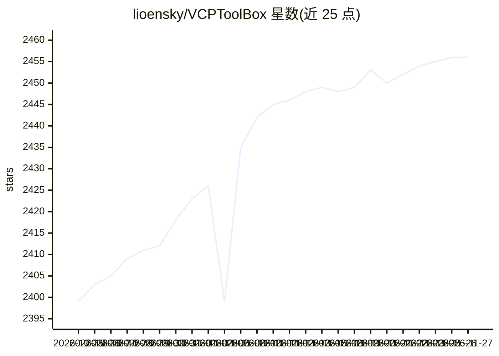

# lioensky/VCPToolBox

⭐ 2,456 · JavaScript · NOASSERTION · 推送 2026-11-26 · [GitHub](https://github.com/lioensky/VCPToolBox) · [官网](https://www.vcptoolbox.com) · 个人维护 · 中文 README

**部署在模型 API 与前端之间的 Agent 运行时与协同中枢**

VCPToolBox 位于 AI 模型 API 与客户端之间，通过统一工具协议、多层级持久化记忆、插件引擎与多 Agent 群聊框架，为接入的大语言模型提供工具调用、记忆检索与审计能力。支持原生 Function Calling 客户端零侵入桥接、MCP 桥、独立记忆 HTTP API，提供 Node.js 服务与 Electron 前端应用群。支持 git clone 与 Docker 部署，采用 CC BY-NC-SA 4.0 许可证，README 提醒勿使用非官方中转 API 且非专业用户谨慎部署。

## 筛选速览

| 维度 | 判定 | 备注 |
|---|---|---|
| AI 角色 | `ai-ecosystem` | LLM/agent 周边工具 |
| 许可风险 | `none` | NOASSERTION |
| 部署形态 | `self-host` | docker 或自建部署 |
| 模型依赖 | — | README 未给出锁定关系 |
| 硬件要求 | — | 无带数字的原话,不猜 |
| 安装摩擦 | `low` | 无编译、无系统依赖或容器化 |
| 成熟度 | — | 结构信号不足 |

## 能力要点

- 原生 FC 零侵入桥接：客户端改出口 URL 即接入全套工具与审计
- 多时间尺度持久化记忆与双曲召回引擎
- V3 统一回执与工具调用事务审计链
- 支持 MCP 桥、独立记忆 API 与多 Agent 群聊

## 适用场景

- 为支持自定义 Base URL 的客户端/IDE Agent 提供统一工具与记忆运行时
- 搭建多 Agent 协作群聊与跨端任务交接
- 自托管可审计、可回滚的 Agent 服务基础设施

## 场景标签

`Agent 框架` `多智能体` `Agent 记忆` · 领域:Agent 开发

## 证据(README 行号)

> L15: **VCP 2.0 是一套多维一体的工业级 Agent 运行时与全生态协同中枢，也是一片基于黎曼双曲几何的终极 AI 背景信息场。**
> L31: 到了 **VCP 2.0**，它早已超越了“API 中间层”的早期定义。它既是能扛住 7×24 小时高并发、可审计、可回滚的**工业级运行时基础设施**，也是让 AI 真正拥有连续生命体验与自主成长能力的**赛博存在底座**。
> L73: ### 1. 彻底打通全生态链：不再被任何前端或协议绑架

## 星数曲线

2026-10-25 2,399 → 2026-11-27 2,456（+57）

---
*卡片 v1 · prompt 1.4 · 生成 2026-11-27 · 置信度 high · 依据 README sha `05ca42324b2c` · [字段定义](../../DATASET.md)*
