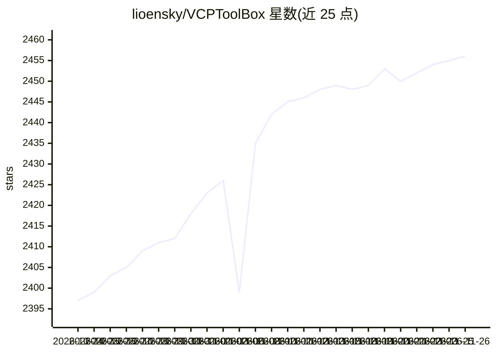

# lioensky/VCPToolBox

⭐ 2,456 · JavaScript · NOASSERTION · 推送 2026-11-25 · [GitHub](https://github.com/lioensky/VCPToolBox) · [官网](https://www.vcptoolbox.com) · 个人维护 · 中文 README

**部署在 AI API 与前端之间的智能体基建中间件**

部署在 AI 模型 API 与前端应用之间的中间件系统，通过统一文本标记协议实现工具调用（不依赖原生 Function Calling）、多层持久化记忆（RiverMemo 拓扑引擎，Rust/Rayon 内核）、六类插件协议与 300+ 官方插件、多 Agent 协作与语义级模型路由。支持分布式节点部署、跨服务器文件访问与多模型容灾。通过 git clone 或 Docker 部署，采用 CC BY-NC-SA 4.0 许可证，禁止商业使用。

## 筛选速览

| 维度 | 判定 | 备注 |
|---|---|---|
| AI 角色 | `ai-ecosystem` | LLM/agent 周边工具 |
| 许可风险 | `none` | NOASSERTION |
| 部署形态 | `self-host` | docker 或自建部署 |
| 模型依赖 | — | README 未给出锁定关系 |
| 硬件要求 | — | 无带数字的原话,不猜 |
| 安装摩擦 | `low` | 无编译、无系统依赖或容器化 |
| 成熟度 | — | 结构信号不足 |

## 能力要点

- 六类插件协议与 300+ 官方插件，支持分布式部署
- 工具调用走纯文本标记协议，不依赖原生 Function Calling
- 浪潮语义动力学记忆引擎，Rust/Rayon 原生内核
- 协议桥接兼容 OpenAI / Anthropic / Gemini API 格式

## 适用场景

- 为 LLM 应用搭建带持久记忆与工具调用的中间层
- 多设备、多模型环境下统一管理智能体
- 部署跨服务器分布式 Agent 节点

## 场景标签

`Agent 框架` `模型网关` · 领域:Agent 开发

## 证据(README 行号)

> L153: - **工具系统**：六类插件协议（同步 / 异步 / 静态 / 服务 / 消息预处理 / 混合），全部支持分布式部署。工具调用走纯文本标记协议，任何能输出文本的模型都能用，不依赖原生 Function Calling，且高度容
> L155: - **模型路由**：语义级自动选模与容灾，按当前对话的逻辑深度和话题方向自动选择最合适的模型，过程对用户透明，跨模型上下文无缝持久化。
> L158: - **前端与兼容**：官方桌面前端 VCPChat（高密度功能集 + 超级渲染引擎）、Vue 管理面板、移动端 VCPMobile；通过协议桥接兼容 OpenAI / Anthropic / Gemini 等多种 API 格式

## 星数曲线

2026-10-24 2,397 → 2026-11-26 2,456（+59）

---
*卡片 v1 · prompt 1.4 · 生成 2026-11-26 · 置信度 high · 依据 README sha `97f09bf585d6` · [字段定义](../../DATASET.md)*
