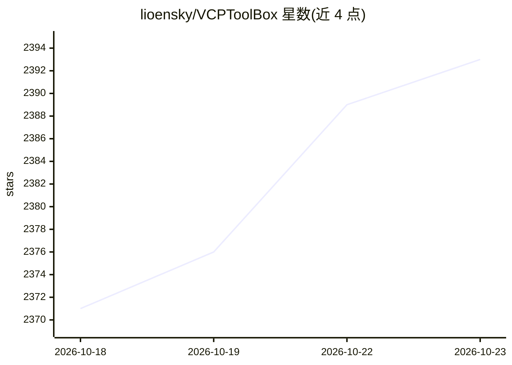

# lioensky/VCPToolBox

⭐ 2,393 · JavaScript · NOASSERTION · 推送 2026-10-22 · [GitHub](https://github.com/lioensky/VCPToolBox) · [官网](https://www.vcptoolbox.com) · 个人维护 · 中文 README

**部署在模型 API 与前端之间的 Agent 基建：记忆、插件、多 Agent**

VCP 部署在 AI 模型 API 与前端应用之间，提供统一指令协议、多层级持久化记忆（浪潮语义动力学引擎、RiverMemo 拓扑 V3，检索排序在 Rust 内核完成）、分布式插件引擎（六类插件协议、300+ 官方插件、纯文本标记协议不依赖原生 Function Calling）、语义级模型路由与变量系统。通过协议桥接兼容 OpenAI/Anthropic/Gemini API 格式，可接管任意前端。面向 AGI OS 开发与探索的开发者，支持 Docker 部署。许可证为 CC BY-NC-SA 4.0（非商业）。README 警告勿使用非官方或反向代理 API。

## 筛选速览

| 维度 | 判定 | 备注 |
|---|---|---|
| AI 角色 | `ai-ecosystem` | LLM/agent 周边工具 |
| 许可风险 | `none` | NOASSERTION |
| 部署形态 | `self-host` | docker 或自建部署 |
| 模型依赖 | — | README 未给出锁定关系 |
| 硬件要求 | — | 无带数字的原话,不猜 |
| 安装摩擦 | `low` | 无编译、无系统依赖或容器化 |
| 成熟度 | — | 结构信号不足 |

## 能力要点

- 六类分布式插件协议，纯文本标记调用，任何能输出文本的模型可用，含 300+ 官方插件
- RiverMemo 拓扑 V3 统一记忆检索排序，计算热路径下沉至 Rust/Rayon 原生内核
- 语义级自动选模与容灾，跨模型上下文无缝持久化
- 协议桥接兼容 OpenAI/Anthropic/Gemini API 格式，官方前端为 VCPChat

## 适用场景

- 为 AI 伴侣/Agent 搭建带持久记忆与连续时间线的后端系统
- 统一管理多模型路由、插件工具与分布式节点部署
- 将任意 OpenAI 兼容前端接入带记忆与工具能力的 Agent 后端

## 场景标签

`Agent 框架` `模型网关` `Agent 记忆` · 领域:Agent 开发

## 证据(README 行号)

> L9: > ⚠️ **部署前请务必阅读**：VCP Agent 拥有分布式系统的底层级权限。请勿使用任何非官方或反向代理的 API（"镜像站""中转 API"）。在底层监控权限下，不可信的 API 可能导致交互数据、记忆库内容、密钥等敏感信
> L161: - **前端与兼容**：官方桌面前端 VCPChat（高密度功能集 + 超级渲染引擎）、Vue 管理面板、移动端 VCPMobile；通过协议桥接兼容 OpenAI / Anthropic / Gemini 等多种 API 格式

## 星数曲线

2026-10-18 2,371 → 2026-10-23 2,393（+22）

---
*卡片 v1 · prompt 1.4 · 生成 2026-10-21 · 置信度 high · 依据 README sha `13fabf840e8d` · [字段定义](../../DATASET.md)*
