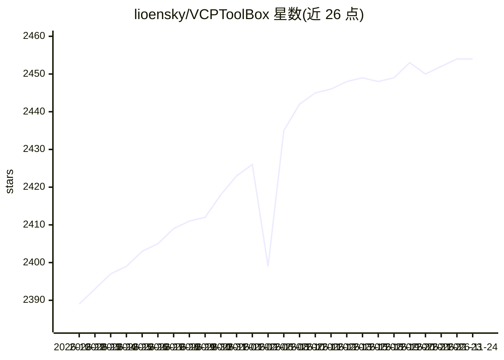

# lioensky/VCPToolBox

⭐ 2,454 · JavaScript · NOASSERTION · 推送 2026-11-22 · [GitHub](https://github.com/lioensky/VCPToolBox) · [官网](https://www.vcptoolbox.com) · 个人维护

**面向 AGI OS 探索的 AI 中间件，部署在模型 API 与前端之间**

部署在 AI 模型 API 与前端应用之间的中间层：通过统一指令协议、持久化记忆引擎、插件系统与多 Agent 协作框架组织 LLM 的上下文与能力调用。工具调用采用纯文本标记协议，不依赖原生 Function Calling；支持语义级自动选模、星型分布式拓扑、跨服务器文件访问与多前端（VCPChat/VCPMobile）。提供 300+ 官方插件，覆盖多媒体生成、检索、通讯等场景，面向希望构建持久化 Agent 系统的开发者。

## 筛选速览

| 维度 | 判定 | 备注 |
|---|---|---|
| AI 角色 | `ai-ecosystem` | LLM/agent 周边工具 |
| 许可风险 | `none` | NOASSERTION |
| 部署形态 | `self-host` | docker 或自建部署 |
| 模型依赖 | — | README 未给出锁定关系 |
| 硬件要求 | — | 无带数字的原话,不猜 |
| 安装摩擦 | `low` | 无编译、无系统依赖或容器化 |
| 成熟度 | — | 结构信号不足 |

## 能力要点

- 六类插件协议，300+ 官方插件，支持分布式部署
- 纯文本标记协议调用工具，不依赖原生 Function Calling
- 语义级自动选模与跨模型上下文持久化
- 基于"浪潮"语义动力学的联想式记忆引擎（RiverMemo 拓扑 V3）

## 适用场景

- 为 AI 助手搭建带持久化记忆与多 Agent 协作的后端
- 用中间层统一接入多种模型 API 并自动路由选模
- 通过插件协议扩展 AI 的多媒体生成、检索与设备控制能力

## 场景标签

`Agent 框架` `模型网关` `多智能体` `Agent 记忆` · 领域:Agent 开发

## 证据(README 行号)

> L9: > ⚠️ **部署前请务必阅读**：VCP Agent 拥有分布式系统的底层级权限。请勿使用任何非官方或反向代理的 API（"镜像站""中转 API"）。在底层监控权限下，不可信的 API 可能导致交互数据、记忆库内容、密钥等敏感信
> L153: - **模型路由**：语义级自动选模与容灾，按当前对话的逻辑深度和话题方向自动选择最合适的模型，过程对用户透明，跨模型上下文无缝持久化。
> L156: - **前端与兼容**：官方桌面前端 VCPChat（高密度功能集 + 超级渲染引擎）、Vue 管理面板、移动端 VCPMobile；通过协议桥接兼容 OpenAI / Anthropic / Gemini 等多种 API 格式

## 星数曲线

2026-10-22 2,389 → 2026-11-24 2,454（+65）

---
*卡片 v1 · prompt 1.4 · 生成 2026-11-23 · 置信度 high · 依据 README sha `fd262252b7f7` · [字段定义](../../DATASET.md)*
