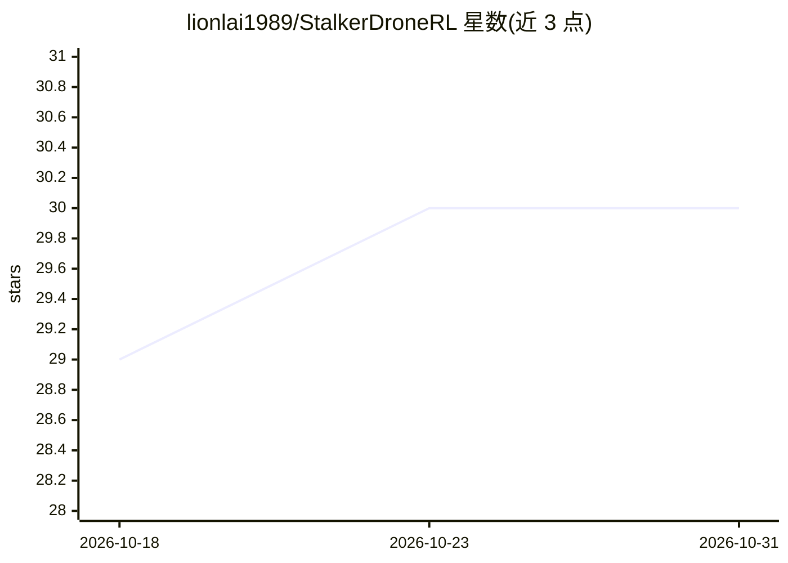

# lionlai1989/StalkerDroneRL

⭐ 30 · Python · Apache-2.0 · 推送 2026-09-27 · [GitHub](https://github.com/lionlai1989/StalkerDroneRL) · 个人维护

**ROS2+Gazebo 全容器化的无人机 RL 追踪目标仿真项目**

在 ROS 2 Humble + Gazebo Harmonic 中仿真四旋翼无人机追踪红色移动球体，控制层提供两条路径：几何 PD 控制器与基于 Gymnasium + Stable Baselines3 训练的 SAC 强化学习控制器。七个 ROS 包覆盖启动编排、感知（红球检测）、导航状态机与 RL 训练，几何控制器、感知、追踪等算法从零实现。全部环境以 Docker 容器交付，docker compose 一键运行；无人机/相机/传感器参数（质量、惯量、FOV 等）可调。README 注明最新提交的 bug 修复后 SAC 控制器需从头重训，旧 commit e862459 可用。

## 筛选速览

| 维度 | 判定 | 备注 |
|---|---|---|
| AI 角色 | `ai-native` | 本体是模型或模型工具 |
| 许可风险 | `permissive` | Apache-2.0 |
| 部署形态 | `self-host` | docker 或自建部署 |
| 模型依赖 | — | README 未给出锁定关系 |
| 硬件要求 | — | 无带数字的原话,不猜 |
| 安装摩擦 | `low` | 无编译、无系统依赖或容器化 |
| 成熟度 | — | 结构信号不足 |

## 能力要点

- 几何控制器与 SAC 强化学习控制器双路径控制
- ROS 2 Humble + Gazebo Harmonic + Gymnasium + Stable Baselines3 集成
- 全 Docker 容器化，docker compose 部署
- 质量/惯量/转子转速/相机 FOV 等参数可按硬件平台调整

## 适用场景

- 学习 ROS 2 + Gazebo + RL 的集成方式
- 复现无人机目标追踪的 RL 训练与推理流程
- 把仿真中的控制器与参数迁移到自己的无人机硬件平台

## 场景标签

`强化学习` · 领域:训练与推理

## 证据(README 行号)

> L4: *stalking a red ball*, utilizing a deep reinforcement learning controller powered by **Gymnasium**
> L54: - **sdrl_rl_controller**: A Reinforcement Learning package that implements the Gymnasium environment

## 星数曲线

2026-10-18 29 → 2026-10-31 30（+1）

---
*卡片 v1 · prompt 1.4 · 生成 2026-10-26 · 置信度 high · 依据 README sha `56cc4c4ee05b` · [字段定义](../../DATASET.md)*
