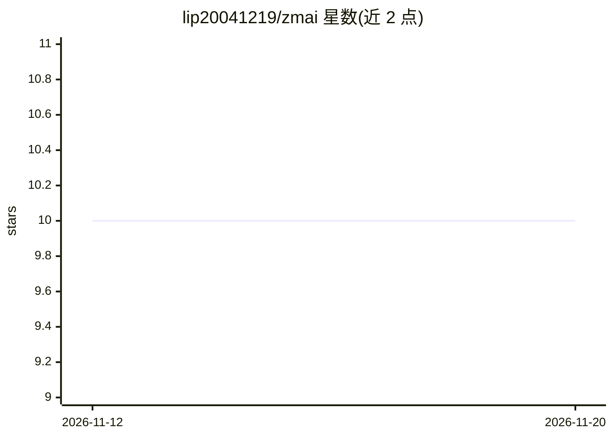

# lip20041219/zmai

⭐ 10 · Python · MIT · 推送 2026-11-12 · [GitHub](https://github.com/lip20041219/zmai) · 个人维护 · 中文 README

**给开发者的自主修复 Bug 的 SWE Agent 运行时**

基于 LLM 的轻量级软件工程 Agent 运行时：输入任务后自动跑测试、解析失败根因、定位并修改代码、验证后自主停止。约 2.5 万行纯 Python 标准库实现，零第三方依赖，可 pip 安装或以库形式嵌入。核心机制包括 TestGuard 测试文件只读保护、LoopGuard 循环检测、有界恢复预算与 fail-closed 完成判定，由 Runtime 而非 LLM 决定任务完成。限制：headless 下 shell 命令直接在本机执行、无官方 SWE-bench 分数、Windows 优先。

## 筛选速览

| 维度 | 判定 | 备注 |
|---|---|---|
| AI 角色 | `ai-native` | 本体是模型或模型工具 |
| 许可风险 | `permissive` | MIT |
| 部署形态 | `library` | 以包/库形式分发 |
| 模型依赖 | locked-api |  |
| 硬件要求 | — | 无带数字的原话,不猜 |
| 安装摩擦 | `low` | 无编译、无系统依赖或容器化 |
| 成熟度 | — | 结构信号不足 |

## 能力要点

- SWE 工作流闭环：测试失败分析→代码定位→修复→验证→自主停止
- 多层防护：TestGuard/AcceptanceGuard/LoopGuard/CompletionState 阻断伪造成功与空转
- 纯 Python 标准库实现，零第三方依赖，1753 个测试
- 多模型网关：DeepSeek/Claude/Gemini/自定义插件，加密凭证存储

## 适用场景

- 自动分析并修复测试失败的业务代码 Bug
- 本地私有环境下运行不外传代码的编码 Agent
- 作为 Python 库嵌入自己的自动化修复流程

## 场景标签

`编码 Agent` · 领域:编码与开发

## 证据(README 行号)

> L18: > **ZMAI** 是一个基于 LLM 的轻量级 SWE Agent，能够自动分析测试失败、定位业务代码、执行修复、运行测试，并在验证成功后停止。
> L22: ZMAI 是一个**开源自主软件工程 Agent 运行时**。给它一个任务（"修复这个 Bug"、"增加这个功能"），它会自主完成：
> L30: 默认后端为 **DeepSeek**，默认模型 **deepseek-v4-flash**（OpenAI-compatible API）。

## 星数曲线

2026-11-12 10 → 2026-11-20 10（+0）

---
*卡片 v1 · prompt 1.4 · 生成 2026-11-19 · 置信度 high · 依据 README sha `8333baa82721` · [字段定义](../../DATASET.md)*
