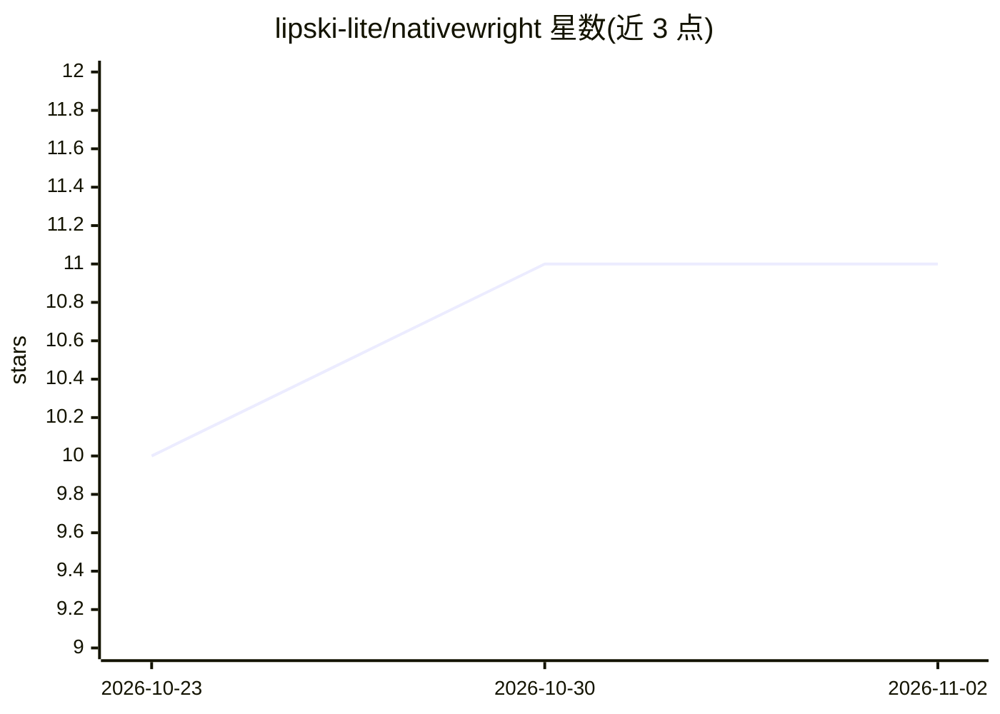

# lipski-lite/nativewright

⭐ 11 · JavaScript · Apache-2.0 · 推送 2026-10-20 · [GitHub](https://github.com/lipski-lite/nativewright) · 个人维护

**给 AI 编码 agent 用的持久化浏览器守护进程**

基于 Patchright（隐身补丁版 Playwright）封装的本地守护进程：AI 编码 agent（Claude Code、Cursor、Codex、Gemini CLI）通过一次性 CLI 命令以 HTTP-RPC 驱动真实 Chrome。持久化 profile 使 cookies、localStorage、设备令牌跨重启保留；内置拟人行为层（Bézier 鼠标轨迹、对数正态击键节奏、Fitts 定律时序、滚动物理），可按调用 --raw 关闭。面向驱动 LLM 网页界面、用订阅版生成工具、无 API SaaS 数据集成、拟人化 E2E 测试等场景。支持 Windows/macOS/Linux，运行时仅依赖 Patchright。

## 筛选速览

| 维度 | 判定 | 备注 |
|---|---|---|
| AI 角色 | `ai-ecosystem` | LLM/agent 周边工具 |
| 许可风险 | `permissive` | Apache-2.0 |
| 部署形态 | `library` | 以包/库形式分发 |
| 模型依赖 | — | README 未给出锁定关系 |
| 硬件要求 | — | 无带数字的原话,不猜 |
| 安装摩擦 | `low` | 无编译、无系统依赖或容器化 |
| 成熟度 | — | 结构信号不足 |

## 能力要点

- 持久化 Chrome profile：登录态跨守护进程重启保留
- 内置拟人行为层（鼠标轨迹/击键节奏/滚动物理），默认开启
- 一次启动守护进程，agent 以一次性 CLI 逐命令驱动浏览器
- 多 agent 共享同一守护进程，各页面独立队列与状态

## 适用场景

- 让编码 agent 持续驱动 Gemini/ChatGPT 等需登录的 LLM 网页界面
- 用已有订阅通过网页 UI 自动化图像/视频生成工具
- 集成无公开 API 的 SaaS 服务中自己的数据
- 以拟人输入时序做 E2E 测试，暴露时序相关 bug

## 场景标签

`浏览器自动化` · 领域:效率与自动化

## 证据(README 行号)

> L4: Give Claude Code, Cursor, Codex, and Gemini CLI a real browser they can steer with one-shot CLI calls — without losi
> L12: Built on top of Patchright — a stealth-patched Playwright fork — NativeWright packages it as a **long-lived localho
> L20: NativeWright solves this with a tiny HTTP-RPC daemon:

## 星数曲线

2026-10-23 10 → 2026-11-02 11（+1）

---
*卡片 v1 · prompt 1.4 · 生成 2026-11-02 · 置信度 high · 依据 README sha `6fea718823bd` · [字段定义](../../DATASET.md)*
