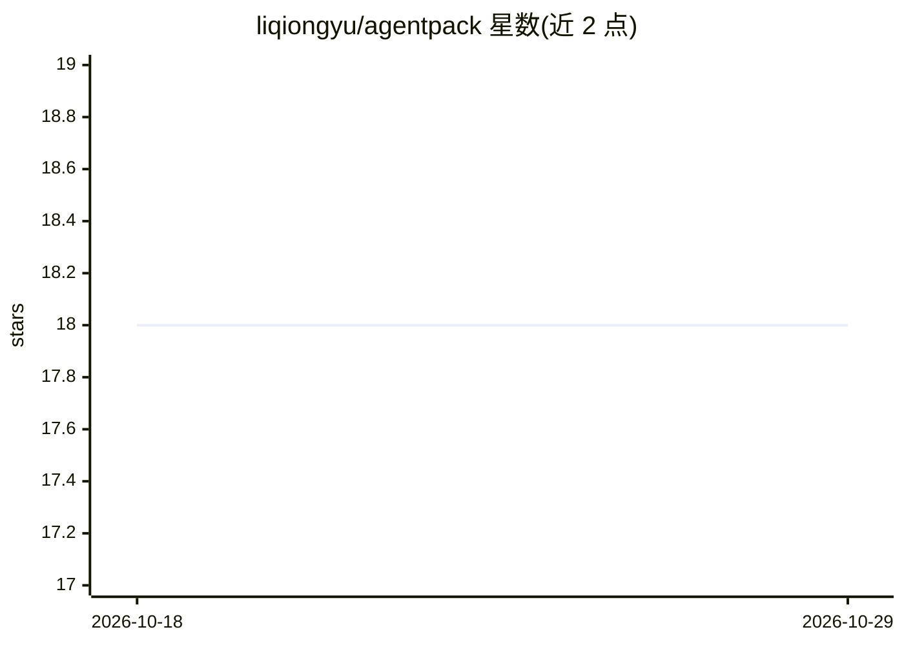

# liqiongyu/agentpack

⭐ 18 · Rust · MIT · 推送 2026-03-07 · [GitHub](https://github.com/liqiongyu/agentpack) · [官网](https://crates.io/crates/agentpack) · 个人维护 · 中文 README

**跨编码 agent 工具声明式部署资产（指令/技能/命令）的控制平面**

面向使用多个编码 agent 工具的开发者：以 manifest（agentpack.yaml）声明 AGENTS.md、SKILL.md、Claude Code 斜杠命令、Codex 自定义提示词等资产，通过目标适配器部署到 Codex、Claude Code、Cursor、VSCode 等工具的发现路径。提供 preview/diff 优先、快照回滚、manifest 级安全删除，支持 git 多机同步与 --json/MCP 自动化契约。以 Rust 实现，经 cargo 或预编译二进制安装，定位区别于 Stow/chezmoi 等 dotfiles 管理器。

## 筛选速览

| 维度 | 判定 | 备注 |
|---|---|---|
| AI 角色 | `ai-ecosystem` | LLM/agent 周边工具 |
| 许可风险 | `permissive` | MIT |
| 部署形态 | `library` | 以包/库形式分发 |
| 模型依赖 | — | README 未给出锁定关系 |
| 硬件要求 | — | 无带数字的原话,不猜 |
| 安装摩擦 | `low` | 无编译、无系统依赖或容器化 |
| 成熟度 | — | 结构信号不足 |

## 能力要点

- manifest 声明式部署 agent 资产到多工具（Codex/Claude Code/Cursor/VSCode）
- preview/diff 优先，快照与 rollback 回滚
- git 多机同步与 --json/MCP 自动化契约

## 适用场景

- 把同一套 agent 指令和技能同步到多个编码工具
- 安全地部署/回滚 agent 资产变更
- 以配置仓库为唯一事实源做多机同步

## 场景标签

`提示工程` · 领域:Agent 开发

## 证据(README 行号)

> L7: Agentpack is an AI-first local “asset control plane” for managing and deploying:
> L15: 1) **Cross-tool consistency**
> L16: - Deploy the same agent assets to multiple tools (Codex, Claude Code, Cursor, VSCode, …) via explicit target adapte

## 星数曲线

2026-10-18 18 → 2026-10-29 18（+0）

---
*卡片 v1 · prompt 1.4 · 生成 2026-10-29 · 置信度 high · 依据 README sha `b45da480fadb` · [字段定义](../../DATASET.md)*
