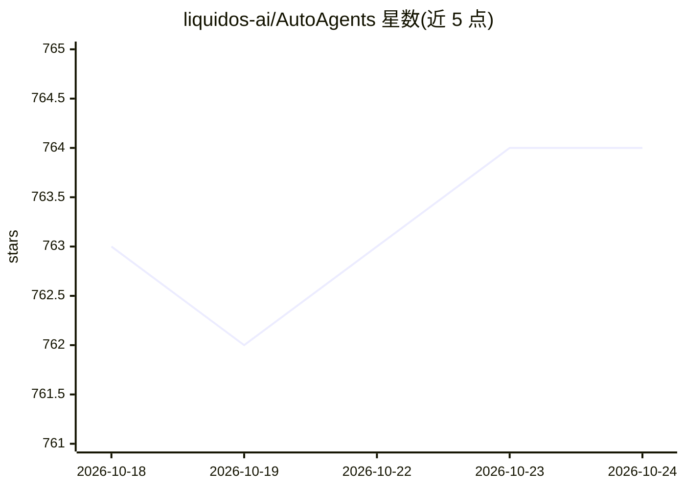

# liquidos-ai/AutoAgents

⭐ 764 · Rust · Apache-2.0 · 推送 2026-10-18 · [GitHub](https://github.com/liquidos-ai/AutoAgents) · [官网](https://liquidos-ai.github.io/AutoAgents/) · 组织维护

**Rust 多智能体框架：构建、编排与运行多个 AI agent**

以 Rust 编写的模块化多智能体框架，面向构建智能系统的开发者。提供类型安全 agent 模型、ReAct 执行器、结构化工具调用、WASM 沙箱工具运行时、滑动窗口记忆、类型化 pub/sub 多智能体编排，以及带缓存/重试等优化 pass 的 LLM pipeline 与输入输出护栏。LLM 后端可插拔：云端含 OpenAI/Anthropic/DeepSeek 等，本地支持 Ollama、Mistral-rs 与 llama.cpp 嵌入式运行时；另有 Python 绑定发布到 PyPI，配套 CLI 从 YAML 运行工作流。限制：PDF 输入在多数 OpenAI 兼容后端被拒绝；CUDA/Vulkan/Metal 需对应本地工具链。

## 筛选速览

| 维度 | 判定 | 备注 |
|---|---|---|
| AI 角色 | `ai-ecosystem` | LLM/agent 周边工具 |
| 许可风险 | `permissive` | Apache-2.0 |
| 部署形态 | `library` | 以包/库形式分发 |
| 模型依赖 | local-ok | 支持本地模型 |
| 硬件要求 | — | 无带数字的原话,不猜 |
| 安装摩擦 | `high` | 编译与系统依赖俱全 |
| 成熟度 | — | 结构信号不足 |

## 能力要点

- ReAct 执行器、流式响应与结构化输出，derive 宏定义工具
- 沙箱化 WASM 工具执行运行时
- 统一接口接入 11 个云端与 3 个本地 LLM 后端（含 llama.cpp/Mistral-rs 嵌入式运行时）
- 带缓存/重试优化 pass 的 LLM pipeline 与可配置输入输出护栏

## 适用场景

- 在 Rust 服务端或边缘环境构建多智能体系统
- 通过 MCP 集成与本地模型（Ollama/llama.cpp）搭建 agent 应用
- 用 YAML 配置定义并通过 HTTP 提供 agentic 工作流
- 在 Python 侧复用该 Rust agent 框架能力

## 场景标签

`Agent 框架` `多智能体` · 领域:Agent 开发

## 证据(README 行号)

> L26: AutoAgents is a modular, multi-agent framework for building intelligent systems in Rust. It combines a type-safe ag
> L27: model with structured tool calling, configurable memory, and pluggable LLM backends. The architecture is designed f

## 星数曲线

2026-10-18 763 → 2026-10-24 764（+1）

---
*卡片 v1 · prompt 1.4 · 生成 2026-10-21 · 置信度 mid · 依据 README sha `fa8a90816a75` · [字段定义](../../DATASET.md)*
