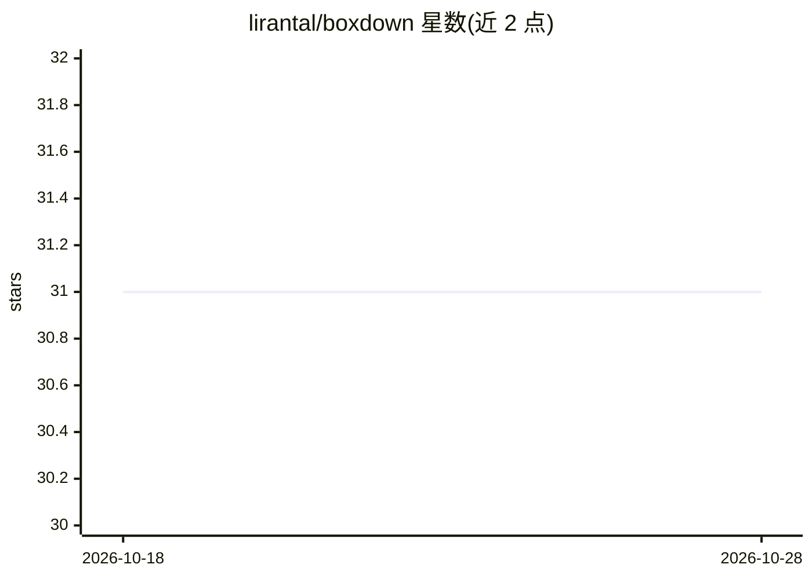

# lirantal/boxdown

⭐ 31 · TypeScript · Apache-2.0 · 推送 2026-10-27 · [GitHub](https://github.com/lirantal/boxdown) · 个人维护

**为编码代理创建隔离 Dev Container 沙箱的 CLI 工具**

面向使用 Claude Code、Codex 等 SSH 编码代理的开发者的命令行工具：为本地项目构建或复用 Docker Dev Container，安装 SSH 别名供远程工具接入，宿主仓库保持干净（生成配置与 SSH 密钥存于缓存/数据目录）。支持 Node/Python/Go/Rust 工具链检测与版本指定，提供 none/auth/full 三级代理档案控制宿主凭证暴露范围。发布版拉取 ghcr.io 预构建镜像，内置 Codex、Claude Code、Snyk 等工具。需 Docker 环境。

## 筛选速览

| 维度 | 判定 | 备注 |
|---|---|---|
| AI 角色 | `ai-ecosystem` | LLM/agent 周边工具 |
| 许可风险 | `permissive` | Apache-2.0 |
| 部署形态 | `self-host` | docker 或自建部署 |
| 模型依赖 | — | README 未给出锁定关系 |
| 硬件要求 | — | 无带数字的原话,不猜 |
| 安装摩擦 | `low` | 无编译、无系统依赖或容器化 |
| 成熟度 | — | 结构信号不足 |

## 能力要点

- 构建/复用 Dev Container 并安装 SSH 别名供编码代理接入
- none/auth/full 三级 agent 档案控制宿主用户凭证暴露范围
- 检测 Node/Python/Go/Rust 声明并指定容器内工具链版本
- 发布版拉取 ghcr.io 预构建镜像，无需宿主安装 Dev Containers CLI

## 适用场景

- 在不污染仓库的前提下为项目搭建隔离的编码代理沙箱
- 让 Cursor、Claude、ChatGPT 等 SSH 工具直接接入容器化工作区
- 控制代理对宿主 Codex/Claude 配置与凭证的访问级别

## 场景标签

 · 领域:开发工具/容器化

## 证据(README 行号)

> L3:  Start and SSH into a reusable Dev Container environment for any local project.
> L135: Agent profiles control host user-scoped coding-agent data. Choose one when a
> L211: `boxdown setup` manages a workspace SSH alias. It writes Codex, Claude, or

## 星数曲线

2026-10-18 31 → 2026-10-28 31（+0）

---
*卡片 v1 · prompt 1.4 · 生成 2026-10-26 · 置信度 mid · 依据 README sha `044ccc9b7f32` · [字段定义](../../DATASET.md)*
