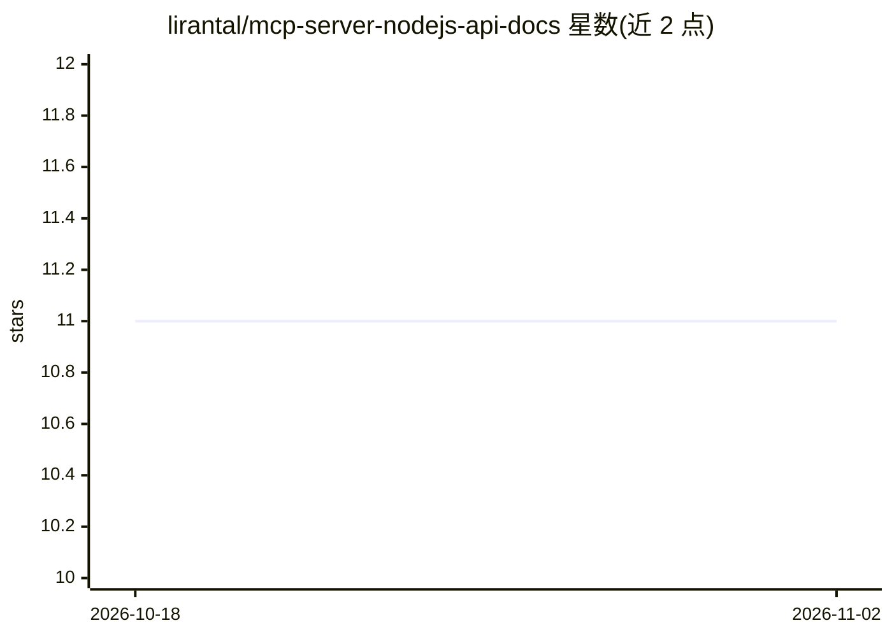

# lirantal/mcp-server-nodejs-api-docs

⭐ 11 · TypeScript · Apache-2.0 · 推送 2026-11-01 · [GitHub](https://github.com/lirantal/mcp-server-nodejs-api-docs) · 个人维护

**为 Claude/Cursor 提供 Node.js API 文档查询的 MCP 服务器**

一个 MCP Server，向 MCP 客户端（如 Claude Desktop、Cursor AI）提供 Node.js API 文档访问能力，以 MCP 工具形式供模型调用。支持三种运行方式：npx 直接运行 CLI、Docker 容器运行、以及写入 MCP 配置文件接入。运行时向系统临时目录写入日志文件供调试。由 Liran Tal 个人维护，采用 Apache-2.0 许可证，提供 npm 安装与 GitHub Container Registry 镜像。

## 筛选速览

| 维度 | 判定 | 备注 |
|---|---|---|
| AI 角色 | `ai-ecosystem` | LLM/agent 周边工具 |
| 许可风险 | `permissive` | Apache-2.0 |
| 部署形态 | `self-host` | docker 或自建部署 |
| 模型依赖 | locked-api |  |
| 硬件要求 | — | 无带数字的原话,不猜 |
| 安装摩擦 | `low` | 无编译、无系统依赖或容器化 |
| 成熟度 | — | 结构信号不足 |

## 能力要点

- 以 MCP Server 形式提供 Node.js API 文档访问
- 支持 npx CLI、Docker 容器两种分发运行方式
- 给出 Claude Desktop 与 Cursor AI 的接入配置示例
- 写入日志文件到系统临时目录用于调试

## 适用场景

- 在 Claude Desktop 中让模型查询 Node.js API 文档
- 在 Cursor AI 中接入 Node.js 文档查询工具
- 通过 Docker 容器方式隔离运行该 MCP 服务器

## 场景标签

`文档问答` · 领域:知识与检索

## 证据(README 行号)

> L3:  An MCP Server for Node.js API documentation
> L30: ## Usage for Claude Desktop:
> L61: ## Usage for Cursor AI:

## 星数曲线

2026-10-18 11 → 2026-11-02 11（+0）

---
*卡片 v1 · prompt 1.4 · 生成 2026-11-02 · 置信度 high · 依据 README sha `ba3998070d07` · [字段定义](../../DATASET.md)*
