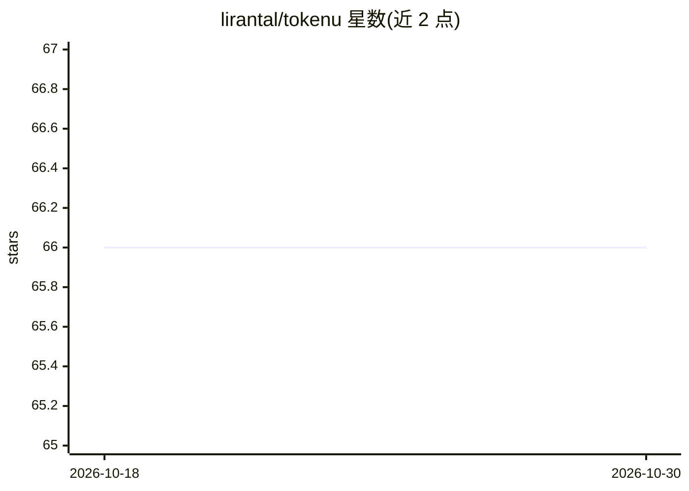

# lirantal/tokenu

⭐ 66 · TypeScript · Apache-2.0 · 推送 2026-10-29 · [GitHub](https://github.com/lirantal/tokenu) · 个人维护

**统计文件与目录 token 占用的类 du 命令行工具**

Node.js 编写的类 Unix du 的 CLI 工具：递归读取项目文件，通过 gpt-tokenizer 库做真实分词（默认 o200k_base，支持 cl100k_base 等多种编码），统计每个文件与目录消耗的 token 数，输出树形、人类可读或 JSON 格式结果。面向在提示词或编码 agent 中输入代码库、需要预估上下文窗口占用的开发者；支持按模型选择编码、glob 排除、默认跳过 .git 与 node_modules。只做度量，不压缩或修改内容。

## 筛选速览

| 维度 | 判定 | 备注 |
|---|---|---|
| AI 角色 | `ai-ecosystem` | LLM/agent 周边工具 |
| 许可风险 | `permissive` | Apache-2.0 |
| 部署形态 | `library` | 以包/库形式分发 |
| 模型依赖 | — | README 未给出锁定关系 |
| 硬件要求 | — | 无带数字的原话,不猜 |
| 安装摩擦 | `low` | 无编译、无系统依赖或容器化 |
| 成熟度 | — | 结构信号不足 |

## 能力要点

- 基于 gpt-tokenizer 的真实分词统计，非估算
- 支持 --model/--encoding 切换编码（o200k_base、cl100k_base 等）
- --json 输出可供 AI agent 编程消费，用于上下文预算规划
- 默认跳过 .git、node_modules 与 .gitignore 命中文件，--no-ignore 可关闭

## 适用场景

- 把目录喂给 LLM 前预估 token 与成本
- 找出项目中悄悄吃掉上下文的大文件
- 为编码 agent 构建读取前 token 阈值钩子

## 场景标签

 · 领域:开发者工具/LLM 上下文计量

## 证据(README 行号)

> L5:  A Unix <code>du</code>-like CLI that counts token usage per file and directory.
> L24: - **Budget context for AI agents** — pipe `--json` output into an autonomous agent pipeline so the agent can plan w
> L177: Actual tokenization. No estimation or approximation. tokenu reads each included file, feeds its content through a 

## 星数曲线

2026-10-18 66 → 2026-10-30 66（+0）

---
*卡片 v1 · prompt 1.4 · 生成 2026-10-24 · 置信度 high · 依据 README sha `31bfb3bb1207` · [字段定义](../../DATASET.md)*
