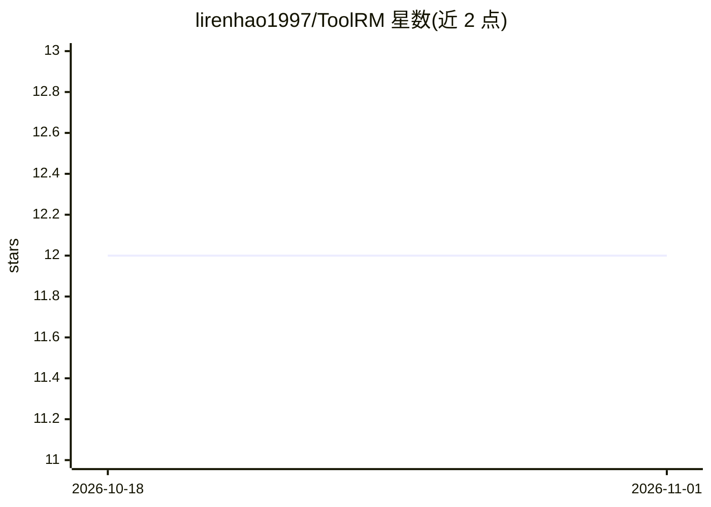

# lirenhao1997/ToolRM

⭐ 12 · Python · NOASSERTION · 推送 2026-01-14 · [GitHub](https://github.com/lirenhao1997/ToolRM) · 组织维护 · 中文 README

**面向 agent 工具调用的奖励模型族及配套数据与基准**

阿里云研究项目 ToolRM，提供轻量生成式与判别式奖励模型（基于 Qwen3-4B/8B 训练），用于 agentic 工具使用场景的偏好判定。配套发布成对偏好数据集 ToolPref-Pairwise-30K（由规则打分与多维采样构建）与评测基准 TRBench-BFCL（基于 BFCL 构建）。模型可扩展至 Best-of-N 采样、自我修正等任务，并支持下游 RL 训练。训练分别通过 verl（生成式）与 OpenRLHF（判别式）进行，评测默认以 vllm 为推理后端，许可证为 CC BY-NC-SA 4.0（非商业）。

## 筛选速览

| 维度 | 判定 | 备注 |
|---|---|---|
| AI 角色 | `ai-ecosystem` | LLM/agent 周边工具 |
| 许可风险 | `none` | NOASSERTION |
| 部署形态 | `None` |  |
| 模型依赖 | local-ok | 支持本地模型 |
| 硬件要求 | — | 无带数字的原话,不猜 |
| 安装摩擦 | `low` | 无编译、无系统依赖或容器化 |
| 成熟度 | — | 结构信号不足 |

## 能力要点

- 基于 Qwen3-4B/8B 的生成式与判别式工具使用奖励模型
- 配套数据集 ToolPref-Pairwise-30K 与评测基准 TRBench-BFCL
- 提供 verl/OpenRLHF 训练脚本与本地评测脚本
- 模型与数据集已在 Hugging Face Collection 发布

## 适用场景

- 训练或直接下载用于 agent 工具调用的奖励模型
- 在 TRBench-BFCL 上评测奖励模型表现
- 用 ToolPref 数据集开展带可验证反馈的 RL 训练研究

## 场景标签

`模型评测` `强化学习` · 领域:评测与运维

## 证据(README 行号)

> L6: **ToolRM** is a family of lightweight generative and discriminative RMs tailored for agentic tool-use scenarios. To 
> L108: ToolRM is a research project developed by Alibaba Cloud and licensed under the CC BY-NC-SA 4.0 License.

## 星数曲线

2026-10-18 12 → 2026-11-01 12（+0）

---
*卡片 v1 · prompt 1.4 · 生成 2026-11-01 · 置信度 high · 依据 README sha `e7c091b40834` · [字段定义](../../DATASET.md)*
