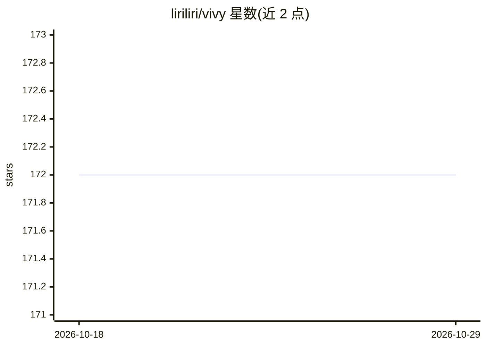

# liriliri/vivy

⭐ 172 · TypeScript · AGPL-3.0 · 推送 2025-11-18 · [GitHub](https://github.com/liriliri/vivy) · [官网](https://vivy.liriliri.io) · 个人维护

**Stable Diffusion 桌面应用：重写 WebUI 界面生成图像**

基于 Electron 的 Stable Diffusion 桌面应用，通过 Stable Diffusion web UI 的 API 重写其用户界面，并捆绑 web UI 本体。提供提示词编辑高亮、Danbooru 标签自动补全、提示词格式化、从生成图像读取参数、图像生成任务队列、图库浏览、界面调整、CPU/内存监控与模型文件管理。应用不含模型文件，用户需自行下载模型放入对应目录。支持 Windows x64 与 Mac arm64 安装包。

## 筛选速览

| 维度 | 判定 | 备注 |
|---|---|---|
| AI 角色 | `ai-native` | 本体是模型或模型工具 |
| 许可风险 | `viral` | AGPL-3.0 |
| 部署形态 | `None` |  |
| 模型依赖 | — | README 未给出锁定关系 |
| 硬件要求 | — | 无带数字的原话,不猜 |
| 安装摩擦 | `low` | 无编译、无系统依赖或容器化 |
| 成熟度 | — | 结构信号不足 |

## 能力要点

- 通过 web UI API 重写界面并捆绑 Stable Diffusion web UI
- 提示词编辑高亮与 Danbooru 标签自动补全
- 图像生成任务队列与从生成图像读取参数
- 模型文件管理与 CPU/内存用量监控

## 适用场景

- 在桌面端运行 Stable Diffusion 生成图像
- 以队列方式批量管理图像生成任务
- 浏览生成图库并复用历史参数

## 场景标签

`图像生成` · 领域:内容生成

## 证据(README 行号)

> L7: Stable diffusion desktop app.
> L14: VIVY is a desktop application for Stable Diffusion that rewrites Stable Diffusion web UI's user interface based on 

## 星数曲线

2026-10-18 172 → 2026-10-29 172（+0）

---
*卡片 v1 · prompt 1.4 · 生成 2026-10-22 · 置信度 high · 依据 README sha `a006a360db92` · [字段定义](../../DATASET.md)*
