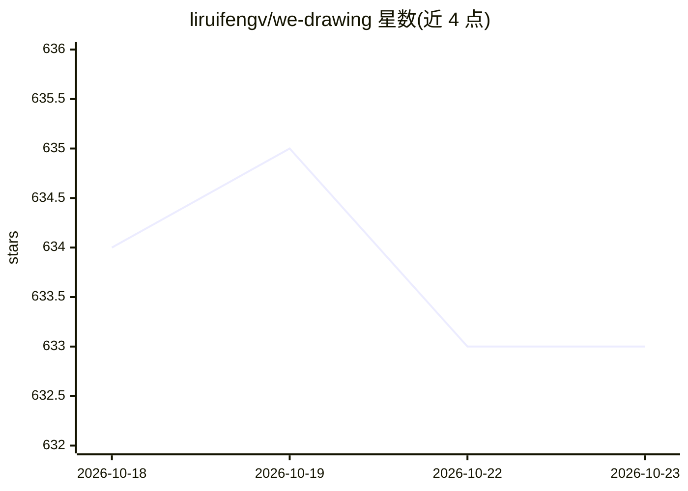

# liruifengv/we-drawing

⭐ 633 · TypeScript · MIT · 推送 2025-12-31 · [GitHub](https://github.com/liruifengv/we-drawing) · [官网](https://we-drawing.com) · 个人维护 · 中文 README

**每天一句中国古诗词自动生成 AI 配图的网站项目**

由 GitHub Action 每日自动触发的文生图项目：从今日诗词 API 获取一句中国古诗词作为 Prompt，调用 302.AI 提供的 Kwai-Kolors/Kolors 模型文生图 API 生成图片，网站用 Astro 构建并发布，提供 RSS 订阅与在线 Demo。使用需在 GitHub Secrets 中配置供应商 API Key。旧版本曾通过 Bing DALL-E-3 生成。面向想部署同类每日生成站点的开发者。

## 筛选速览

| 维度 | 判定 | 备注 |
|---|---|---|
| AI 角色 | `ai-native` | 本体是模型或模型工具 |
| 许可风险 | `permissive` | MIT |
| 部署形态 | `None` |  |
| 模型依赖 | — | README 未给出锁定关系 |
| 硬件要求 | — | 无带数字的原话,不猜 |
| 安装摩擦 | `low` | 无编译、无系统依赖或容器化 |
| 成熟度 | — | 结构信号不足 |

## 能力要点

- GitHub Action 每日自动生成诗词配图
- 调用 302.AI 文生图 API（Kwai-Kolors/Kolors 模型）
- 诗词来源为今日诗词 API
- Astro 构建网站并提供 RSS 订阅

## 适用场景

- 部署一个每天自动更新的诗词配图网站
- 通过 RSS 订阅每日诗词图片
- 参考其 Action 自动化流程做类似每日生成项目

## 场景标签

`图像生成` · 领域:内容生成

## 证据(README 行号)

> L9: - 本项目是使用 302.AI 提供的 `Kwai-Kolors/Kolors` 模型，每天一句中国古诗词作为 Prompt，生成诗词图片。
> L13: - 使用302.AI 文生图 API

## 星数曲线

2026-10-18 634 → 2026-10-23 633（-1）

---
*卡片 v1 · prompt 1.4 · 生成 2026-10-21 · 置信度 high · 依据 README sha `f56dbff74287` · [字段定义](../../DATASET.md)*
