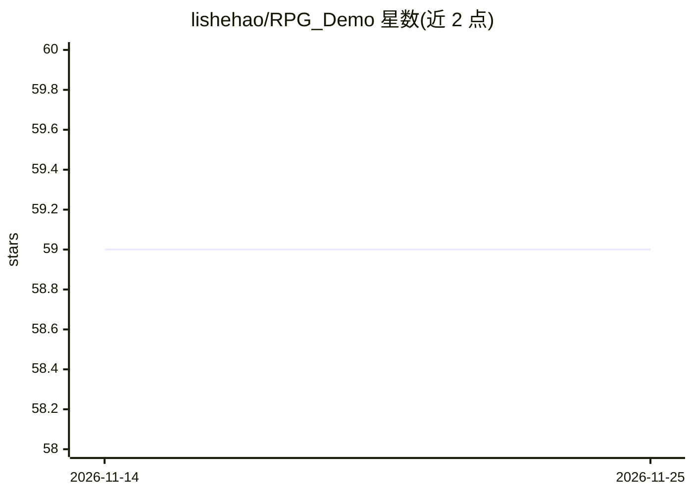

# lishehao/RPG_Demo

⭐ 59 · Python · NOASSERTION · 推送 2026-11-14 · [GitHub](https://github.com/lishehao/RPG_Demo) · [官网](https://lishehao.github.io/RPG_Demo/) · 个人维护 · 中文 README

**LLM 交互式故事系统：一个前提生成 12 回合剧情**

面向手机端短篇故事玩家的交互叙事系统：用户给出一个前提，系统经 story compiler 生成角色、隐藏目标与筹码，进入 12 回合的固定节奏循环（读场景、比较选项或自由输入行动、看结果）。LLM 只负责写作文本，回合结构、状态与持久化由代码控制；叙事者、顾问、结局编译器分角色运行，并提供带种子与逐回合状态的 reviewer 视图、会话保存与回放。后端 FastAPI + SQLite，前端 React/Vite。有 key 时接 OpenAI 兼容端点，无 key 时可用固定文本的离线模式；README 声明这是作品集案例研究，非经验证的消费产品，frontend/ 目录已停止维护。

## 筛选速览

| 维度 | 判定 | 备注 |
|---|---|---|
| AI 角色 | `ai-native` | 本体是模型或模型工具 |
| 许可风险 | `permissive` | NOASSERTION |
| 部署形态 | `None` |  |
| 模型依赖 | — | README 未给出锁定关系 |
| 硬件要求 | — | 无带数字的原话,不猜 |
| 安装摩擦 | `low` | 无编译、无系统依赖或容器化 |
| 成熟度 | `idea` | |

## 能力要点

- story compiler → 12 回合循环 → 结局编译器的固定游戏循环结构
- 叙事者/顾问/结局编译器三种 LLM 角色分离，顾问只读不可改写剧情
- 会话保存、回放与逐回合 reviewer 视图（种子、库存、结局状态）
- APP_LLM_MODE=fake 离线模式，无需 API key 即可体验 UI 与 API 流程

## 适用场景

- 在手机上玩一局短篇互动故事，而非面对空白写作画布
- 体验带状态管理与回放审查的 LLM 叙事系统
- 作为 LLM 游戏循环设计的作品集案例学习

## 场景标签

`AI 写作` · 领域:内容生成

## 证据(README 行号)

> L3: An interactive story system: one premise becomes a 12-turn story of choices or free actions, with saved sessions, re
> L41: consequence to pick the next move. The LLM writes the prose; the code around

## 星数曲线

2026-11-14 59 → 2026-11-25 59（+0）

---
*卡片 v1 · prompt 1.4 · 生成 2026-11-18 · 置信度 mid · 依据 README sha `0030d17dcd02` · [字段定义](../../DATASET.md)*
