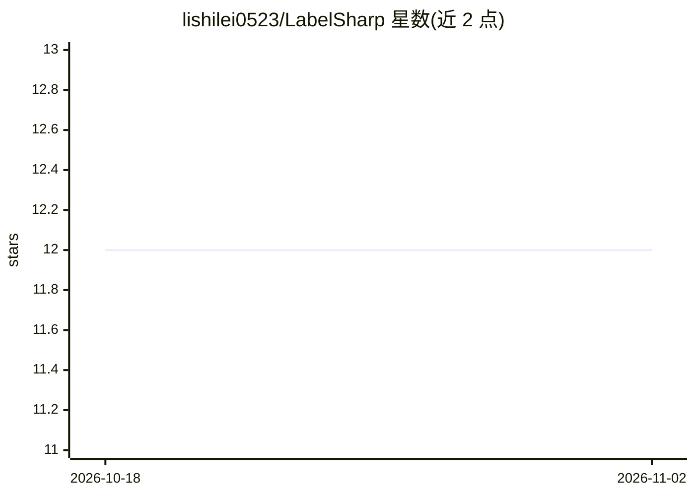

# lishilei0523/LabelSharp

⭐ 12 · C# · MIT · 推送 2026-07-06 · [GitHub](https://github.com/lishilei0523/LabelSharp) · 个人维护 · 中文 README

**面向深度学习的图像标注工具，兼容 LabelMe 格式**

基于 WPF/Canvas 的 Windows 桌面图像标注软件，面向深度学习计算机视觉数据标注人员。提供点、线段、画刷、矩形、旋转矩形、圆形、椭圆、多边形、折线段等标注类型，支持导入/导出 PascalVOC、YOLO 目标检测/图像分割/定向边框格式及批量格式转换，另含图像切割、掩膜保存工具。自带 YOLO v11 目标检测与图像分割模型做辅助标注；算法部分使用 OpenCV 与 OnnxRuntime。README 未给出安装/运行命令。

## 筛选速览

| 维度 | 判定 | 备注 |
|---|---|---|
| AI 角色 | `ai-enhanced` | 去掉 AI 部分产品仍成立 |
| 许可风险 | `permissive` | MIT |
| 部署形态 | `None` |  |
| 模型依赖 | — | README 未给出锁定关系 |
| 硬件要求 | — | 无带数字的原话,不猜 |
| 安装摩擦 | `low` | 无编译、无系统依赖或容器化 |
| 成熟度 | — | 结构信号不足 |

## 能力要点

- 兼容 LabelMe 格式，覆盖多种常用标注形状
- 支持 PascalVOC 与 YOLO 系列格式的导入导出与批量转换
- 自带 YOLO v11 检测与分割模型辅助标注
- 图像切割与掩膜保存工具

## 适用场景

- 为深度学习模型训练准备目标检测/分割数据集
- 在 PascalVOC 与 YOLO 格式之间批量转换标注
- 借助模型辅助标注加快大批量图片的标注速度

## 场景标签

 · 领域:计算机视觉/数据标注

## 证据(README 行号)

> L4: > 专注于深度学习计算机视觉图像标注操作，兼容LabelMe格式，包含大多数常用标注功能；
> L6: > 自带YOLO v11目标检测与图像分割模型辅助标注；

## 星数曲线

2026-10-18 12 → 2026-11-02 12（+0）

---
*卡片 v1 · prompt 1.4 · 生成 2026-11-01 · 置信度 high · 依据 README sha `e435a30c368e` · [字段定义](../../DATASET.md)*
