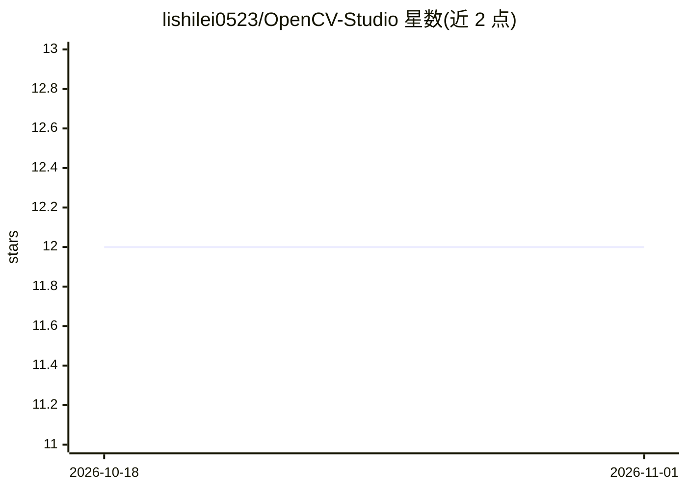

# lishilei0523/OpenCV-Studio

⭐ 12 · C# · MIT · 推送 2026-07-06 · [GitHub](https://github.com/lishilei0523/OpenCV-Studio) · 个人维护 · 中文 README

**OpenCV 算法可视化操作桌面工具，供算法开发人员测试调试**

基于 WPF（MahApps.Metro/Caliburn.Micro 等）构建的 OpenCV 功能可视化操作工具：将预处理、几何变换、分割、特征提取、匹配、相机标定等 OpenCV 常用算法封装为界面操作，另含深度学习模块，通过 OnnxRuntime 部署 ResNet 分类、FasterRCNN/YOLO 系列检测分割及 PaddleOCR 识别。面向算法开发人员用于测试调试算法。未在 README 中给出安装运行步骤。

## 筛选速览

| 维度 | 判定 | 备注 |
|---|---|---|
| AI 角色 | `ai-enhanced` | 去掉 AI 部分产品仍成立 |
| 许可风险 | `permissive` | MIT |
| 部署形态 | `None` |  |
| 模型依赖 | — | README 未给出锁定关系 |
| 硬件要求 | — | 无带数字的原话,不猜 |
| 安装摩擦 | `low` | 无编译、无系统依赖或容器化 |
| 成熟度 | — | 结构信号不足 |

## 能力要点

- 以可视化方式封装 OpenCV 常用算法（预处理/分割/特征/匹配/标定）
- OnnxRuntime 部署 ResNet、FasterRCNN、YOLO 系列、PaddleOCR 等模型
- 基于 WPF Canvas 的图像算法交互界面

## 适用场景

- 在图形界面中测试调试 OpenCV 图像算法
- 验证深度学习模型（分类/检测/分割/OCR）的部署效果
- 进行相机标定与畸变矫正实验

## 场景标签

`图像视频处理` `目标检测` `OCR` · 领域:感知与多模态

## 证据(README 行号)

> L3: #### 项目说明
> L26:  颜色空间、形态学、空间滤波、频率滤波、灰度变换、边缘检测、污点矫正、曝光融合等；
> L44:  ResNet图像分类、FasterRCNN目标检测、YOLO目标检测、YOLO定向目标检测、YOLO图像分割、PaddleOCR字符识别；

## 星数曲线

2026-10-18 12 → 2026-11-01 12（+0）

---
*卡片 v1 · prompt 1.4 · 生成 2026-11-01 · 置信度 mid · 依据 README sha `8a180edc30aa` · [字段定义](../../DATASET.md)*
