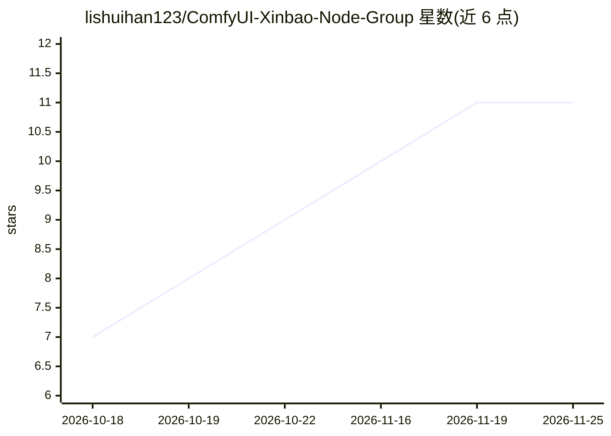

# lishuihan123/ComfyUI-Xinbao-Node-Group

⭐ 11 · Python · MIT · 推送 2026-11-19 · [GitHub](https://github.com/lishuihan123/ComfyUI-Xinbao-Node-Group) · 个人维护 · 中文 README

**为 ComfyUI 用户提供图片标准化、构图与提示词组合的节点集合**

作者自用并长期维护的 ComfyUI 自定义节点集合，统一归类为「心宝♥节点组」。功能包括：按图像模型标准尺寸自动标准化输入图、13 种预设比例的交互式裁切、纯色/透明 PNG 颜色面板、画布内移动缩放旋转产品图的构图节点、批量 LoRA 叠加加载、透视提示词生成、脸部外轮廓拼合、深度视频阈值调节、18 种光效提示词组合，以及文本联结、PSD 合成、SAM+GroundingDINO 本地抠图等辅助节点。姿态检测基于 RTMLib+ONNX Runtime 在 CPU 运行，模型需手动放置。

## 筛选速览

| 维度 | 判定 | 备注 |
|---|---|---|
| AI 角色 | `ai-ecosystem` | LLM/agent 周边工具 |
| 许可风险 | `permissive` | MIT |
| 部署形态 | `library` | 以包/库形式分发 |
| 模型依赖 | — | README 未给出锁定关系 |
| 硬件要求 | — | 无带数字的原话,不猜 |
| 安装摩擦 | `low` | 无编译、无系统依赖或容器化 |
| 成熟度 | — | 结构信号不足 |

## 能力要点

- 交互式构图节点同时输出合成图片与产品遮罩
- 批量加载并叠加多个 LoRA，逐项调节强度 0–2
- 透视调节与打光搭档节点输出结构化中文提示词
- 检测依赖缺失不影响其他节点导入，模型不自动下载

## 适用场景

- 为 Qwen-Image 等模型准备符合标准尺寸的输入图
- 在画布内对产品图进行交互式构图与合成
- 批量管理 LoRA 并组合打光、透视提示词
- 用 SAM+GroundingDINO 按提示词本地抠图

## 场景标签

`提示工程` `图像生成` · 领域:Agent 开发

## 证据(README 行号)

> L3: `ComfyUI-Xinbao-Node-Group` 是心宝自用并长期维护的实用 ComfyUI 节点集合。以后新增的通用自定义节点会继续放进这个仓库，ComfyUI 中的分类统一为 `心宝♥节点组`。
> L124: - **心宝♥图像分割**：使用 SAM + GroundingDINO 按提示词进行本地抠图。
> L144: `心宝♥推理（极速版）` 已拆分为独立项目：`ComfyUI-Xinbao-Inference-Fast`。需要提示词扩写、图片/视频反推时请单独安装该仓库。

## 星数曲线

2026-10-18 7 → 2026-11-25 11（+4）

---
*卡片 v1 · prompt 1.4 · 生成 2026-11-19 · 置信度 mid · 依据 README sha `d6e13f84a435` · [字段定义](../../DATASET.md)*
