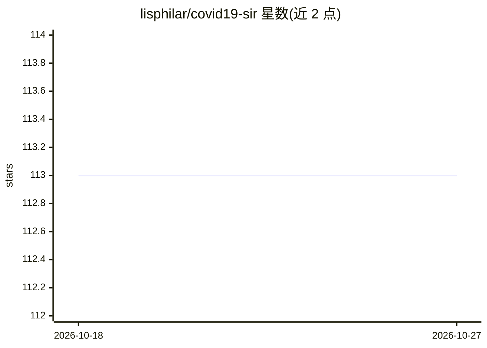

# lisphilar/covid19-sir

⭐ 113 · Jupyter Notebook · Apache-2.0 · 推送 2026-10-24 · [GitHub](https://github.com/lisphilar/covid19-sir) · [官网](https://lisphilar.github.io/covid19-sir/) · 组织维护

**用相位依赖 SIR 系模型分析 COVID-19 等疫情数据的 Python 库**

面向传染病数据分析的 Python 库：可下载 COVID-19、猴痘 2022 等数据集，进行数据准备与时序分段，用 SIR-F 等相位依赖 ODE 模型做参数估计、各国病例数预测与情景模拟，并支持研究再生数与各国措施的关系。提供 pip 安装、文档教程与 API 参考。项目起源于 Kaggle Notebook，由志愿者社区开发，SIR-F 模型、S-R 变点分析等方法在项目内提出，无原始论文。要求 Python 3.10 以上。

## 筛选速览

| 维度 | 判定 | 备注 |
|---|---|---|
| AI 角色 | `ai-native` | 本体是模型或模型工具 |
| 许可风险 | `permissive` | Apache-2.0 |
| 部署形态 | `library` | 以包/库形式分发 |
| 模型依赖 | — | README 未给出锁定关系 |
| 硬件要求 | — | 无带数字的原话,不猜 |
| 安装摩擦 | `low` | 无编译、无系统依赖或容器化 |
| 成熟度 | — | 结构信号不足 |

## 能力要点

- SIR-F 等相位依赖 SIR 系 ODE 模型的参数估计与模拟
- 自动下载数据集并分析各国/地区记录
- 情景分析与病例数预测
- SIR-F 模型与 S-R 变点分析方法在本项目中提出

## 适用场景

- 监控 COVID-19/猴痘在各国传播并预测病例数
- 做情景分析辅助数据驱动的防疫决策
- 研究再生数与各国防控措施的关系

## 场景标签

`科研工具` · 领域:学习与行业

## 证据(README 行号)

> L19:  CovsirPhy is a Python library for infectious disease (COVID-19: Coronavirus disease 2019, Monkeypox 2022) data ana
> L26: * Predict the number of cases in each country/province

## 星数曲线

2026-10-18 113 → 2026-10-27 113（+0）

---
*卡片 v1 · prompt 1.4 · 生成 2026-10-23 · 置信度 mid · 依据 README sha `fc6a18d2c849` · [字段定义](../../DATASET.md)*
