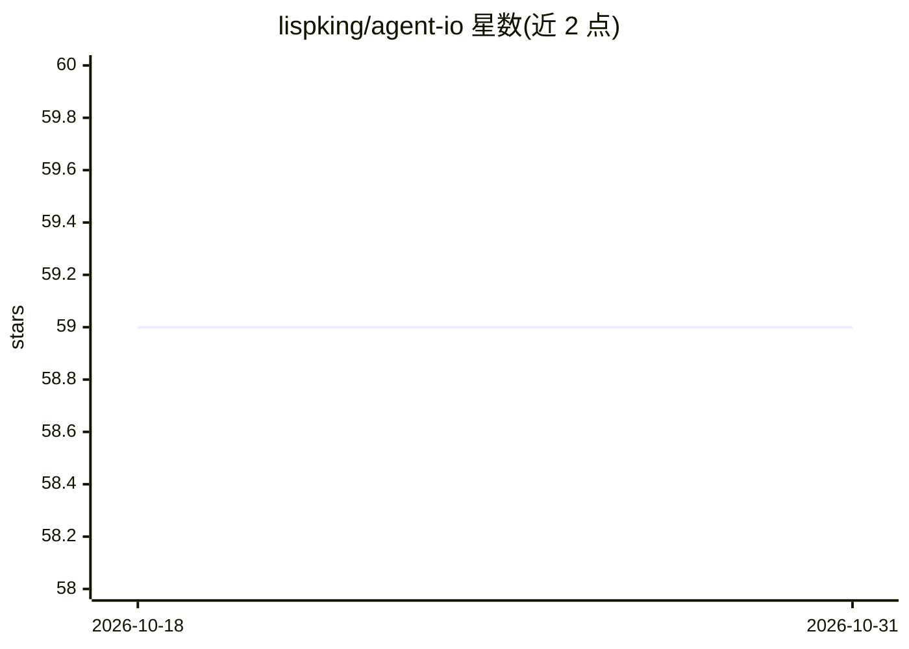

# lispking/agent-io

⭐ 59 · Rust · 推送 2026-03-25 · [GitHub](https://github.com/lispking/agent-io) · [官网](https://crates.io/crates/agent-io) · 个人维护

**Rust 语言的多供应商 AI agent 构建 SDK**

面向 Rust 开发者的 AI agent 开发工具包：通过 Cargo 依赖引入，提供多供应商 LLM 接入（OpenAI、Anthropic、Gemini、DeepSeek、Groq、Mistral、Ollama、OpenRouter 及 OpenAI 兼容端点），内置工具/函数调用（#[tool] 宏自动生成 JSON Schema）、流式响应、上下文压缩、token 用量与成本追踪、指数退避重试。默认内存式记忆，可选 LanceDB 特性开启持久化向量记忆。仓库为 Cargo workspace，含主 crate 与 proc-macro crate。

## 筛选速览

| 维度 | 判定 | 备注 |
|---|---|---|
| AI 角色 | `ai-ecosystem` | LLM/agent 周边工具 |
| 许可风险 | `permissive` | — |
| 部署形态 | `library` | 以包/库形式分发 |
| 模型依赖 | local-ok | 支持本地模型 |
| 硬件要求 | — | 无带数字的原话,不猜 |
| 安装摩擦 | `low` | 无编译、无系统依赖或容器化 |
| 成熟度 | — | 结构信号不足 |

## 能力要点

- #[tool] 宏从 async fn 自动生成工具定义与 JSON Schema 映射
- 多供应商 LLM 支持含 OpenAI 兼容端点与本地 Ollama
- 上下文压缩、token 成本追踪、指数退避重试内置
- 可选 LanceDB 特性提供持久化向量记忆

## 适用场景

- 在 Rust 项目中构建带工具调用的 AI agent
- 跨多家 LLM 供应商切换或统一接入
- 长对话场景下自动压缩上下文并追踪 token 成本

## 场景标签

`Agent 框架` · 领域:Agent 开发

## 证据(README 行号)

> L9: A Rust SDK for building AI agents with multi-provider LLM support.
> L13: - **Multi-provider LLM support**: OpenAI, Anthropic, Google Gemini, and OpenAI-compatible providers

## 星数曲线

2026-10-18 59 → 2026-10-31 59（+0）

---
*卡片 v1 · prompt 1.4 · 生成 2026-10-24 · 置信度 high · 依据 README sha `5ff87eb4cdc7` · [字段定义](../../DATASET.md)*
