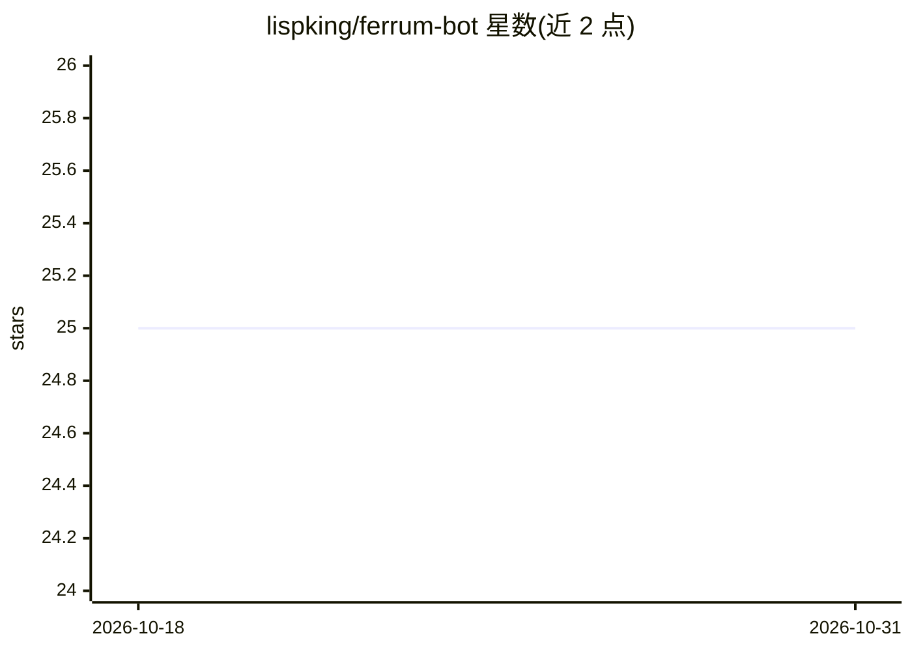

# lispking/ferrum-bot

⭐ 25 · Rust · Apache-2.0 · 推送 2026-02-10 · [GitHub](https://github.com/lispking/ferrum-bot) · 个人维护 · 中文 README

**Rust 编写的个人 agent 运行时与 CLI，带工具/频道/定时任务**

用 Rust 实现的本地优先个人 agent 运行时：统一 agent + 工具 + 频道 + cron 模型，提供交互式 agent REPL 与单次消息模式。内置 file/exec/web/message/cron/spawn 工具框架，默认启用工作区限制、危险命令守卫与 SSRF 防护（web_fetch 屏蔽 localhost 与私网 IP）。支持 11 个模型 provider 配置（Anthropic/OpenAI/OpenRouter/DeepSeek/Groq/Zhipu/DashScope/vLLM/Gemini/Moonshot/AIHubMix），网关模式含 WhatsApp 出站适配器与 Telegram/Discord/Feishu 脚手架适配器。通过 cargo 构建运行。

## 筛选速览

| 维度 | 判定 | 备注 |
|---|---|---|
| AI 角色 | `ai-ecosystem` | LLM/agent 周边工具 |
| 许可风险 | `permissive` | Apache-2.0 |
| 部署形态 | `None` |  |
| 模型依赖 | local-ok | 支持本地模型 |
| 硬件要求 | — | 无带数字的原话,不猜 |
| 安装摩擦 | `low` | 无编译、无系统依赖或容器化 |
| 成熟度 | — | 结构信号不足 |

## 能力要点

- 统一 agent + tools + channels + cron 的运行时模型，含交互式 REPL
- 工具框架含危险命令守卫与 SSRF 防护的 web_fetch
- 11 个 provider 配置支持（含 vLLM 自定义 api_base）
- 持久会话与定时任务（cron）管理

## 适用场景

- 在本地终端日常运行带工具的个人 agent
- 通过 WhatsApp/Telegram/Discord/飞书频道接入 agent
- 为 agent 配置定时任务与会话持久化

## 场景标签

`Agent 框架` · 领域:Agent 开发

## 证据(README 行号)

> L3: Rust-native personal agent runtime and CLI.
> L11: - Unified model of `agent + tools + channels + cron`

## 星数曲线

2026-10-18 25 → 2026-10-31 25（+0）

---
*卡片 v1 · prompt 1.4 · 生成 2026-10-27 · 置信度 high · 依据 README sha `d4b5a4afe3f9` · [字段定义](../../DATASET.md)*
