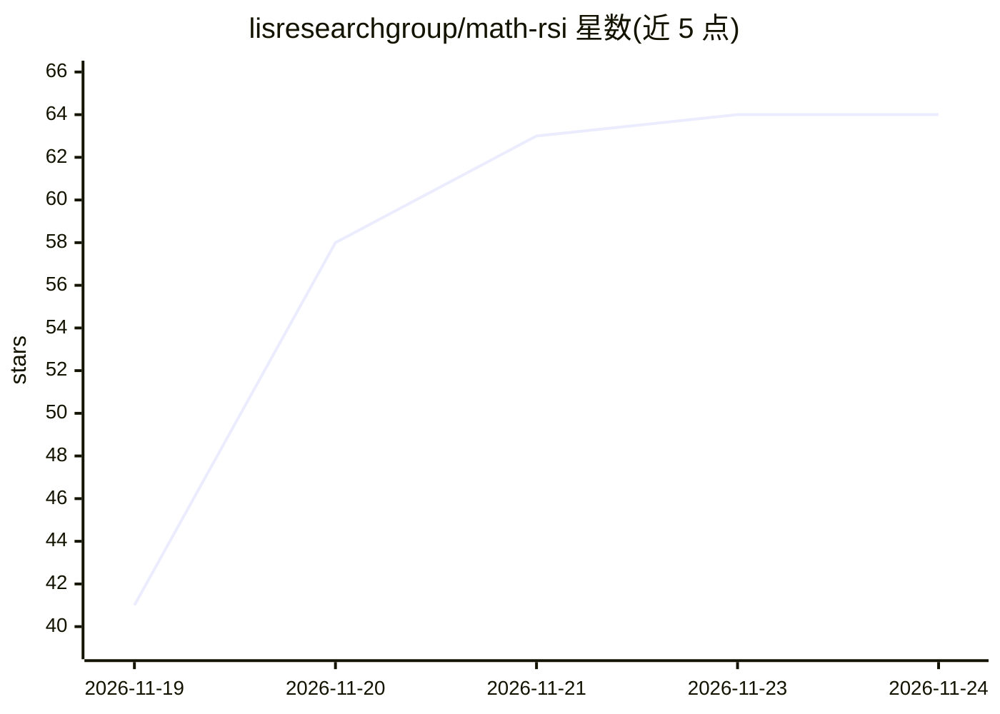

# lisresearchgroup/math-rsi

⭐ 66 · Lean · MIT · 推送 2026-11-23 · [GitHub](https://github.com/lisresearchgroup/math-rsi) · [官网](https://lisresearchgroup.github.io/math-rsi/) · 组织维护 · 中文 README

**面向数学发现与证明的自改进 agent 技能包，适配 Claude Code 与 Codex**

MathRSI 提供一套 Markdown 形式的 skills 与领域验证器，供 Claude Code 与 Codex 在数学研究任务中使用：共享的 Prepare→Route→Prove→Verify→Handoff 五阶段流程配合领域插件与按问题维护的任务 wiki，产出证明并交由 Lean 4、DRAT 等可验证格式核查。三层结构分离基础流程、领域插件与任务工作区；另设 mathrsi-meta-evolve 维护流程，将研究证据回写为基础行为与插件的更新。流程与脚本以 MIT 许可发布，发布 v1–v6 快照标签。

## 筛选速览

| 维度 | 判定 | 备注 |
|---|---|---|
| AI 角色 | `ai-ecosystem` | LLM/agent 周边工具 |
| 许可风险 | `permissive` | MIT |
| 部署形态 | `None` |  |
| 模型依赖 | — | README 未给出锁定关系 |
| 硬件要求 | — | 无带数字的原话,不猜 |
| 安装摩擦 | `low` | 无编译、无系统依赖或容器化 |
| 成熟度 | — | 结构信号不足 |

## 能力要点

- 五阶段研究循环：Prepare→Route→Prove→Verify→Handoff
- 三层结构：base 基础流程、plugins 领域插件、任务工作区（spec/wiki/证明/证书）
- 可验证证明产出：Lean 4 与 CNF+DRAT 证书
- mathrsi-meta-evolve 维护流程将研究证据回写为流程改进

## 适用场景

- 为一个新的数学问题启动文献调研与路线探索的 agent 研究
- 检查并修复候选证明或局部引理中的缺口
- 在中断后恢复既有研究，继续未完成的证明工作

## 场景标签

`编码 Agent` `科研工具` · 领域:编码与开发

## 证据(README 行号)

> L3: **A self-improving agent harness for mathematical discovery and proof.** Readable Markdown skills and domain verifie
> L11: MathRSI pairs a shared base workflow with domain plugins and a per-problem research wiki, guiding Claude Code and C
> L62: The main `mathrsi-research` skill coordinates **Prepare → Route → Prove → Verify → Handoff**, entering from current

## 星数曲线

2026-11-19 41 → 2026-11-24 64（+23）

---
*卡片 v1 · prompt 1.4 · 生成 2026-11-19 · 置信度 high · 依据 README sha `e7655264b40d` · [字段定义](../../DATASET.md)*
