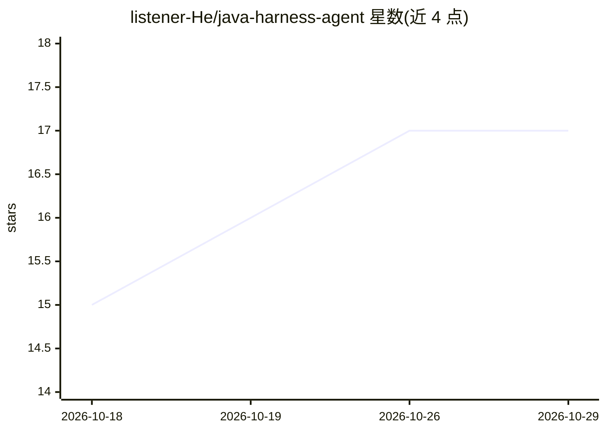

# listener-He/java-harness-agent

⭐ 17 · Python · MIT · 推送 2026-05-31 · [GitHub](https://github.com/listener-He/java-harness-agent) · [官网](https://blog.hehouhui.cn/archives/java-harness-agent-intent-driven-development-practice) · 个人维护 · 中文 README

**约束 Claude Code 行为的 Java 开发 agent 协议框架**

面向 Java 后端开发者的 Claude Code harness：定义规则、角色、技能与六阶段生命周期（Explorer → Propose → Review → Implement → QA → Archive），通过 task_brief.md 契约、TDD 循环、scope_guard 边界钩子与阶段门（/h-gates）约束 AI 编码助手行为。架构分四层（Sensor/Insight/Policy/Enforce），采用拉取式事件模型降低每提示词开销。含风险分级路由与 WAL 知识归档；本仓库非 Java 库，是协议与工具集，入口为 CLAUDE.md。

## 筛选速览

| 维度 | 判定 | 备注 |
|---|---|---|
| AI 角色 | `ai-ecosystem` | LLM/agent 周边工具 |
| 许可风险 | `permissive` | MIT |
| 部署形态 | `None` |  |
| 模型依赖 | — | README 未给出锁定关系 |
| 硬件要求 | — | 无带数字的原话,不猜 |
| 安装摩擦 | `low` | 无编译、无系统依赖或容器化 |
| 成熟度 | — | 结构信号不足 |

## 能力要点

- 6 阶段生命周期与 13 类专家角色约束 AI 编码流程
- PDD→BDD→SDD→TDD 闭环与 task_brief.md 统一契约
- 四层架构：hooks 观测、事件拉取模型（默认 0 token 注入）
- scope_guard.py 强制 Allowed Scope，WAL 片段做知识归档

## 适用场景

- 让 AI 编码助手按规范完成 Java 后端任务并留存证据
- 高风险任务经人工审批门后再实现
- 将完成任务沉淀为可复用的项目知识库

## 场景标签

`编码 Agent` `Agent 框架` · 领域:Agent 开发

## 证据(README 行号)

> L3: An AI agent harness framework for structured, sustainable software engineering. It defines a set of rules, roles, sk
> L9: This repository is **not** a Java library or application. It is a protocol and toolset that sits between a human dev

## 星数曲线

2026-10-18 15 → 2026-10-29 17（+2）

---
*卡片 v1 · prompt 1.4 · 生成 2026-10-29 · 置信度 high · 依据 README sha `5560b5392424` · [字段定义](../../DATASET.md)*
