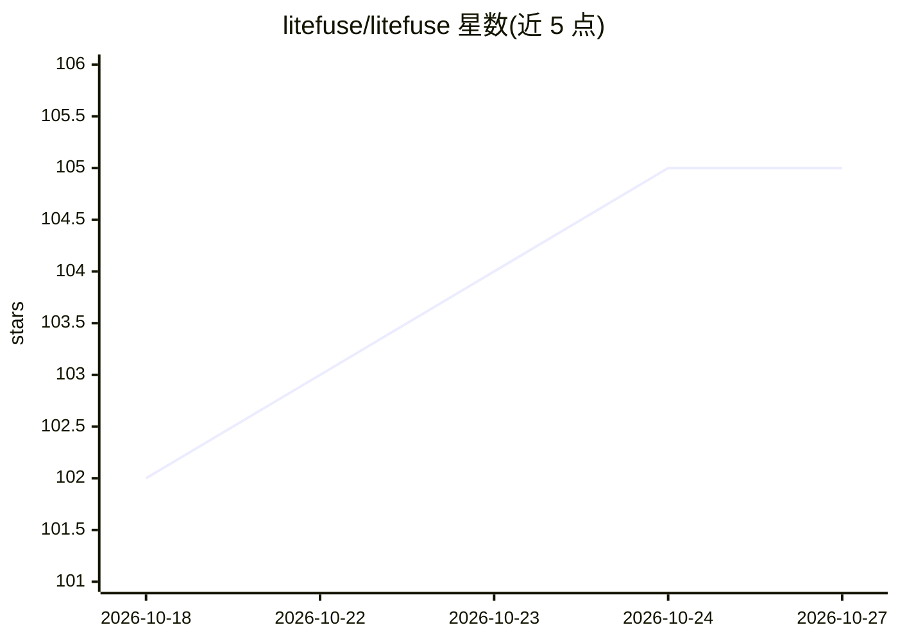

# litefuse/litefuse

⭐ 105 · TypeScript · NOASSERTION · 推送 2026-10-14 · [GitHub](https://github.com/litefuse/litefuse) · [官网](https://litefuse.ai) · 组织维护 · 中文 README

**开源 LLM 工程平台：团队协作开发、监控、评测与调试 AI 应用**

Langfuse 的 fork，将分析后端替换为 Apache Doris，并保持与上游 Langfuse API 的线路协议兼容，官方 langfuse SDK 与兼容的 OpenTelemetry exporter 可直接指向 Litefuse 使用。功能包括 LLM 应用追踪可观测、Prompt 集中管理与版本控制、LLM-as-a-judge 与用户反馈等评测、数据集基准测试、Playground 与 API/SDK。支持托管云或自托管（Docker Compose、Kubernetes Helm、Terraform）。面向构建 LLM 应用的团队，MIT 许可，自托管实例默认上报使用统计（可关闭）。

## 筛选速览

| 维度 | 判定 | 备注 |
|---|---|---|
| AI 角色 | `ai-ecosystem` | LLM/agent 周边工具 |
| 许可风险 | `none` | NOASSERTION |
| 部署形态 | `self-host` | docker 或自建部署 |
| 模型依赖 | — | README 未给出锁定关系 |
| 硬件要求 | — | 无带数字的原话,不猜 |
| 安装摩擦 | `low` | 无编译、无系统依赖或容器化 |
| 成熟度 | — | 结构信号不足 |

## 能力要点

- 追踪 LLM 调用、检索、embedding 与 agent 动作的可观测性
- Prompt 集中管理、版本控制与服务端/客户端缓存
- LLM-as-a-judge、用户反馈、人工标注与自定义评测管线
- 与上游 Langfuse API 线路协议兼容，官方 SDK 零代码改动接入

## 适用场景

- 为 LLM 应用接入调用追踪并调试复杂日志与用户会话
- 团队集中管理 Prompt 版本并协作迭代
- 用数据集与评测管线做部署前测试和持续改进
- 在自有基础设施上自托管 LLMOps 平台

## 场景标签

`LLM 可观测性` `模型评测` `提示工程` · 领域:Agent 开发

## 证据(README 行号)

> L39: Litefuse is an **open source LLM engineering** platform. It helps teams collaboratively
> L50: - Evaluations are key to the LLM application development workflow, and Litefuse adapts to your needs. It supports L

## 星数曲线

2026-10-18 102 → 2026-10-27 105（+3）

---
*卡片 v1 · prompt 1.4 · 生成 2026-10-23 · 置信度 mid · 依据 README sha `2eea9db28eb7` · [字段定义](../../DATASET.md)*
