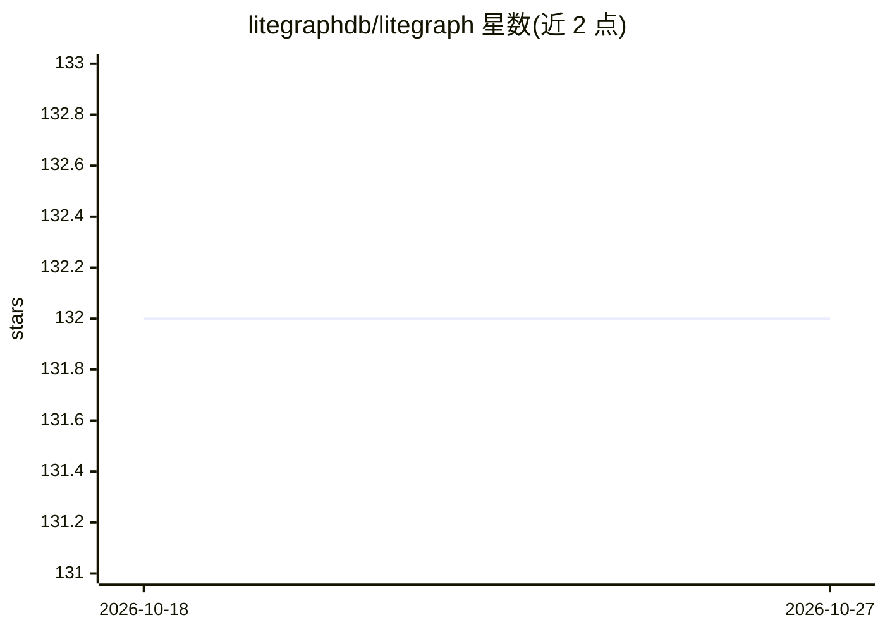

# litegraphdb/litegraph

⭐ 132 · C# · 推送 2026-10-23 · [GitHub](https://github.com/litegraphdb/litegraph) · [官网](https://litegraphdb.com) · 组织维护

**面向 AI 应用的多模态属性图数据库：图+JSON+向量+MCP 一体化**

用 .NET 编写的属性图数据库，把图关系、标签、JSON 数据与向量检索放在同一持久层，支持嵌入式（LiteGraphClient）、独立 REST 服务器、官方 C#/Python/JavaScript SDK、Next.js 仪表盘与 MCP 服务器（HTTP/TCP/WebSocket）多种使用方式。存储后端为 SQLite（进程内 HnswLite 向量索引）或 PostgreSQL+pgvector，v10 起支持多节点集群。内置图算法（PageRank、社区检测等 11 种）、图域事务，以及租户注册 OpenAI/Ollama/Gemini/Anthropic/VoyageAI 端点后的 LLM 图数据对话（SSE 流式、RBAC、工具循环）。PostgreSQL 部署需 pgvector 扩展，v10 升级不可回退到 9.x。

## 筛选速览

| 维度 | 判定 | 备注 |
|---|---|---|
| AI 角色 | `ai-ecosystem` | LLM/agent 周边工具 |
| 许可风险 | `none` | — |
| 部署形态 | `self-host` | docker 或自建部署 |
| 模型依赖 | local-ok | 支持本地模型 |
| 硬件要求 | — | 无带数字的原话,不猜 |
| 安装摩擦 | `low` | 无编译、无系统依赖或容器化 |
| 成熟度 | — | 结构信号不足 |

## 能力要点

- 单一持久层覆盖图、标签、JSON 与 HNSW 向量检索（SQLite 进程内或 pgvector）
- MCP 服务器（HTTP/TCP/WebSocket）供 AI agent 操作图数据
- 五类 LLM 提供商端点的图数据对话，带 RBAC、SSE 流式与每轮统计
- 11 种图算法（中心性/PageRank/社区检测）可在客户端、REST、MCP、查询语言中调用

## 适用场景

- 为 RAG/agent 应用提供带向量检索的知识持久层
- 通过 MCP 让 AI agent 读写与查询图数据
- 部署多节点集群承载生产图+向量负载

## 场景标签

`向量数据库` · 领域:知识与检索

## 证据(README 行号)

> L7: LiteGraph is a property graph database for applications that need graph relationships, tags, labels, JSON data, and 
> L22: - LLM chat over graph data with five provider types, SSE streaming, an in-process graph tool loop, and vector retri
> L23: - MCP server with HTTP, TCP, and WebSocket transports

## 星数曲线

2026-10-18 132 → 2026-10-27 132（+0）

---
*卡片 v1 · prompt 1.4 · 生成 2026-10-23 · 置信度 high · 依据 README sha `085ed3d104c3` · [字段定义](../../DATASET.md)*
