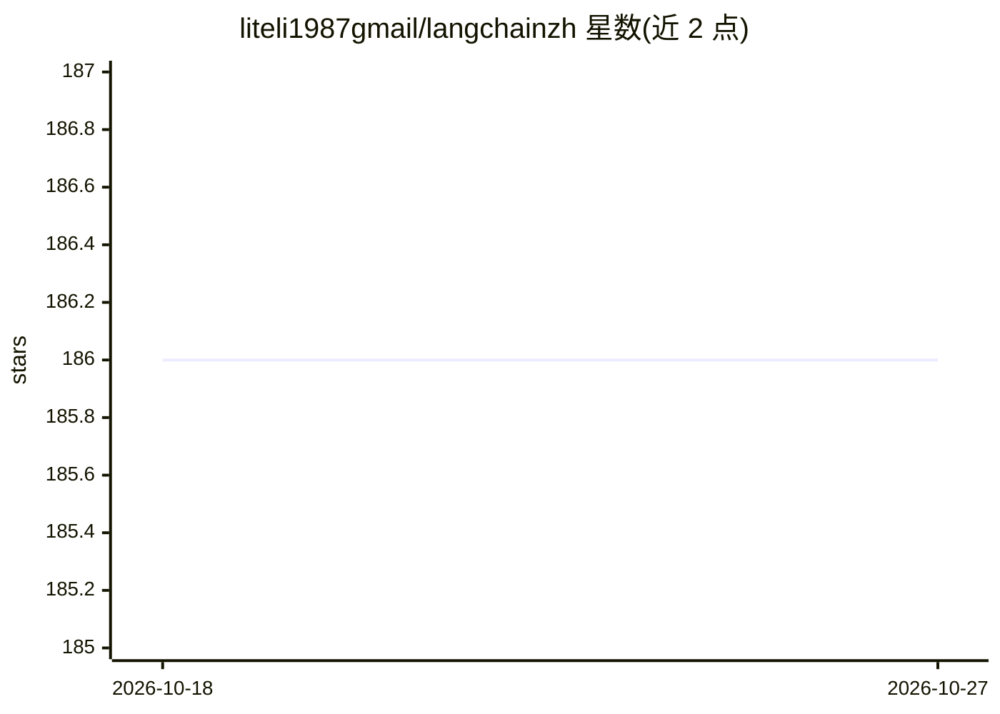

# liteli1987gmail/langchainzh

⭐ 186 · HTML · MIT · 推送 2026-06-28 · [GitHub](https://github.com/liteli1987gmail/langchainzh) · [官网](http://langchain.com.cn) · 个人维护 · 中文 README

**LangChain 官方文档的中文翻译镜像站**

将官方 LangChain 英文文档自动翻译为中文并发布镜像的社区项目。机制：GitHub Actions 每天定时检查上游 langchain-ai/docs 仓库，使用 MiniMax OpenAI-compatible API 完成中文翻译，经 uv run pipeline build 构建，通过 Mintlify CLI 渲染并部署至 Vercel 或 Cloudflare Pages。README 声明项目正从 2023 年旧版 Nextra 站升级到新流程。版权归属 LangChain 作者 Harrison Chase，本项目仅做翻译。

## 筛选速览

| 维度 | 判定 | 备注 |
|---|---|---|
| AI 角色 | `ai-knowledge` | 知识聚合/清单类 |
| 许可风险 | `permissive` | MIT |
| 部署形态 | `None` |  |
| 模型依赖 | — | README 未给出锁定关系 |
| 硬件要求 | — | 无带数字的原话,不猜 |
| 安装摩擦 | `low` | 无编译、无系统依赖或容器化 |
| 成熟度 | — | 结构信号不足 |

## 能力要点

- GitHub Actions 每日自动检查并同步上游官方文档
- 使用 MiniMax OpenAI-compatible API 做中文翻译
- Mintlify CLI 渲染，可发布到 Vercel 或 Cloudflare Pages

## 适用场景

- 中文读者阅读 LangChain 官方文档
- 参与社区协作翻译与纠错

## 场景标签

 · 领域:开发文档/知识翻译

## 证据(README 行号)

> L3: > 当前仓库正在从 2023 年旧版 Nextra 文档站升级为自动同步官方 LangChain Mintlify 文档的中文镜像。
> L9: - 中文翻译：MiniMax OpenAI-compatible API
> L19: Langchain中文网的目的是帮助中国人阅读 Langchain 的文档。

## 星数曲线

2026-10-18 186 → 2026-10-27 186（+0）

---
*卡片 v1 · prompt 1.4 · 生成 2026-10-22 · 置信度 high · 依据 README sha `d3d3731d6f3b` · [字段定义](../../DATASET.md)*
