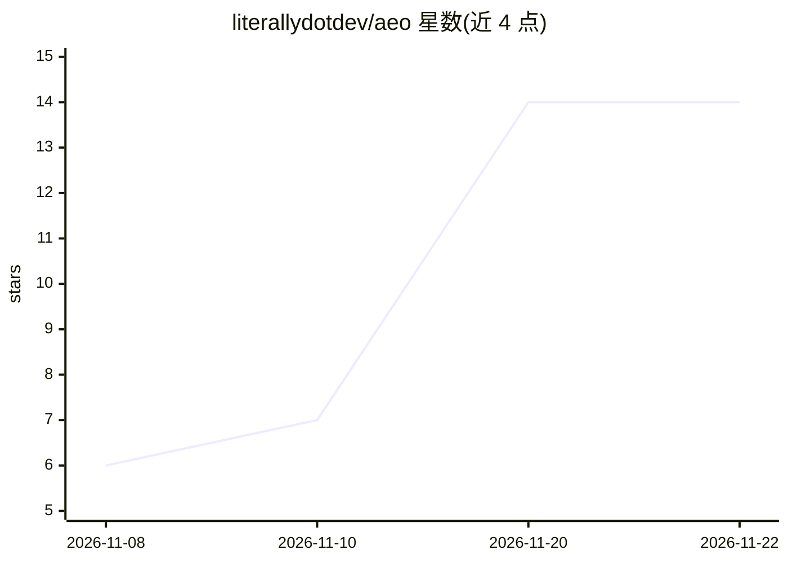

# literallydotdev/aeo

⭐ 14 · TypeScript · MIT · 推送 2026-11-17 · [GitHub](https://github.com/literallydotdev/aeo) · [官网](https://www.literally.dev) · 组织维护

**本地运行的 AI 可见性（AEO）审计 CLI：检查 AI 助手是否提及并引用你的品牌**

literally-aeo 是一个本地运行的命令行审计工具，向 ChatGPT、Claude、Gemini、Perplexity、Google AI Overviews 及编码代理（Claude Code、Codex、Cursor）等提问，统计答案中对指定品牌的提及率与引用率，并生成可离线验证的证据包。使用用户自己的 provider 密钥，经 Vercel AI Gateway 与 DataForSEO 调用；单模型负责评判、核查与撰写报告，运行前需批准费用上限（--max-usd）。无遥测上传；需 Node.js 24+，编码代理表面需各自 CLI 登录。

## 筛选速览

| 维度 | 判定 | 备注 |
|---|---|---|
| AI 角色 | `ai-native` | 本体是模型或模型工具 |
| 许可风险 | `permissive` | MIT |
| 部署形态 | `library` | 以包/库形式分发 |
| 模型依赖 | — | README 未给出锁定关系 |
| 硬件要求 | — | 无带数字的原话,不猜 |
| 安装摩擦 | `low` | 无编译、无系统依赖或容器化 |
| 成熟度 | — | 结构信号不足 |

## 能力要点

- 对聊天助手、AI Overviews、消费端应用与编码代理多表面测量提及/引用率
- 本地运行，使用自己的 provider 密钥，无遥测与上传
- 费用上限审批机制与 plan 命令的成本预估
- 每个比率附计数与 Wilson 95% 区间

## 适用场景

- 审计品牌在 AI 助手回答中的可见度与引用情况
- 追踪优化前后可见性指标的变化
- 按国家与语言配置审计市场范围

## 场景标签

`模型评测` · 领域:评测与运维

## 证据(README 行号)

> L3: Measure how AI assistants answer the questions your buyers ask: whether they
> L4: mention you, cite you, and who they recommend instead. `literally-aeo` runs
> L41: npm install -g literally-aeo

## 星数曲线

2026-11-08 6 → 2026-11-22 14（+8）

---
*卡片 v1 · prompt 1.4 · 生成 2026-11-20 · 置信度 high · 依据 README sha `e6af4a3a64bb` · [字段定义](../../DATASET.md)*
