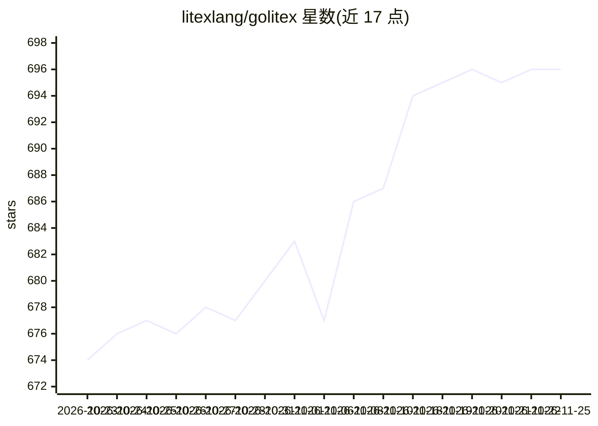

# litexlang/golitex

⭐ 696 · Rust · Apache-2.0 · 推送 2026-11-18 · [GitHub](https://github.com/litexlang/golitex) · [官网](https://litexlang.com) · 个人维护 · 中文 README

**面向形式化数学的高级验证语言，可编译到 Lean 4**

Litex 是一种形式化数学编程语言，采用类 Python 语法书写定义、事实与证明步骤，编译器自动验证表达式良定义性、检查定义域约束并搜索上下文事实。验证通过后生成可追溯的 JSON 证明记录，可编译为独立的 Lean 4 文件做独立内核验证，架构设计支持扩展到 Coq 与 Isabelle；还支持导出 LaTeX、交互式阅读、提取 Python/C 代码。提供持久会话 REPL 与 JSON 诊断，README 将其定位为适合 AI agent 提出并修复证明步骤的语言。当前为 Beta 阶段。

## 筛选速览

| 维度 | 判定 | 备注 |
|---|---|---|
| AI 角色 | `ai-enhanced` | 去掉 AI 部分产品仍成立 |
| 许可风险 | `permissive` | Apache-2.0 |
| 部署形态 | `None` |  |
| 模型依赖 | — | README 未给出锁定关系 |
| 硬件要求 | — | 无带数字的原话,不猜 |
| 安装摩擦 | `low` | 无编译、无系统依赖或容器化 |
| 成熟度 | `idea` | |

## 能力要点

- 类数学书写语法，de Bruijn 因子接近 1
- 自动验证定义域义务与良定义性
- 证明可编译为 Lean 4 文件做独立内核验证
- 持久会话 REPL 与可追溯 JSON 诊断记录

## 适用场景

- 用类数学语法书写并被机器验证的证明
- 将已验证证明导出为 LaTeX 讲义或论文
- 让 AI agent 在会话中逐步提出并修正证明步骤
- 将数学定义提取为可执行的 Python/C 代码

## 场景标签

`科研工具` · 领域:学习与行业

## 证据(README 行号)

> L14: **Litex is a high-level programming language for formal mathematics.**
> L129: ### 4. Built for AI Mathematicians (Agent-Native Architecture)

## 星数曲线

2026-10-23 674 → 2026-11-25 696（+22）

---
*卡片 v1 · prompt 1.4 · 生成 2026-11-24 · 置信度 mid · 依据 README sha `eee65b57db41` · [字段定义](../../DATASET.md)*
