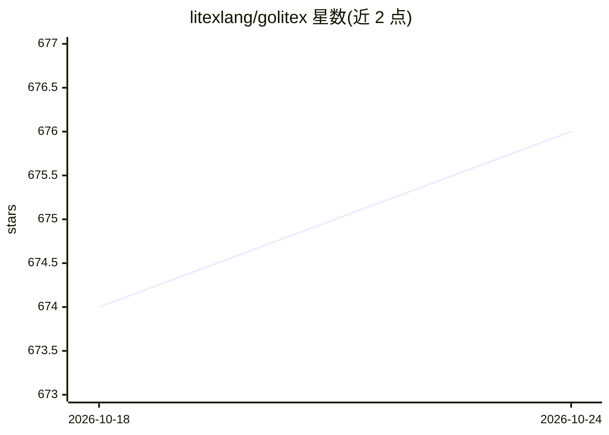

# litexlang/golitex

⭐ 676 · Rust · Apache-2.0 · 推送 2026-10-22 · [GitHub](https://github.com/litexlang/golitex) · [官网](https://litexlang.com) · 个人维护 · 中文 README

**让数学陈述直接机器可检验的形式化语言与验证器**

Litex 是一门以集合论为基础、语法贴近日常数学书写的形式语言及其验证器：用户用类 Python 缩进写出定义、条件与结论，验证器通过结构化事实查找、有界递归验证与内置数学规则逐步检查推理，并以 JSON 输出接受/拒绝理由（含未满足条件）。支持中文反馈（-lang zh）、持久会话（-session）中保留已接受知识，以及实验性生成 Lean 语句与证明的编译器（litex -lean）。面向希望以惯常数学写法产出机器可检验证明的数学用户与 AI agent，自称实验性 beta，通过 Homebrew（macOS/Linux）或在线 playground 使用。

## 筛选速览

| 维度 | 判定 | 备注 |
|---|---|---|
| AI 角色 | `ai-ecosystem` | LLM/agent 周边工具 |
| 许可风险 | `permissive` | Apache-2.0 |
| 部署形态 | `None` |  |
| 模型依赖 | — | README 未给出锁定关系 |
| 硬件要求 | — | 无带数字的原话,不猜 |
| 安装摩擦 | `low` | 无编译、无系统依赖或容器化 |
| 成熟度 | `idea` | |

## 能力要点

- 数学陈述本身即形式源码，验证器直接读取并检查（含定义域与前提条件）
- 结构化事实查找 + 有界递归验证 + 内置规则，逐步构建数学上下文
- JSON 输出报告接受/拒绝理由与存储事实，支持 -lang zh 中文反馈
- 实验性 -lean 编译器生成 Lean 语句与证明，可由 Lean 独立复核

## 适用场景

- 以接近教科书的写法书写并机器检验数学定义、事实与证明步骤
- AI agent 在持久会话中提出步骤、查看反馈并迭代修正证明
- 将 Litex 验证结果转换为 Lean 语句与证明做独立核对

## 场景标签

 · 领域:形式化数学/定理验证

## 证据(README 行号)

> L196: A person or AI agent can propose a step, inspect the feedback, and revise it.
> L205: to generate Lean statements and proofs along supported routes. Lean can then

## 星数曲线

2026-10-18 674 → 2026-10-24 676（+2）

---
*卡片 v1 · prompt 1.4 · 生成 2026-10-21 · 置信度 mid · 依据 README sha `6616f3f5a479` · [字段定义](../../DATASET.md)*
