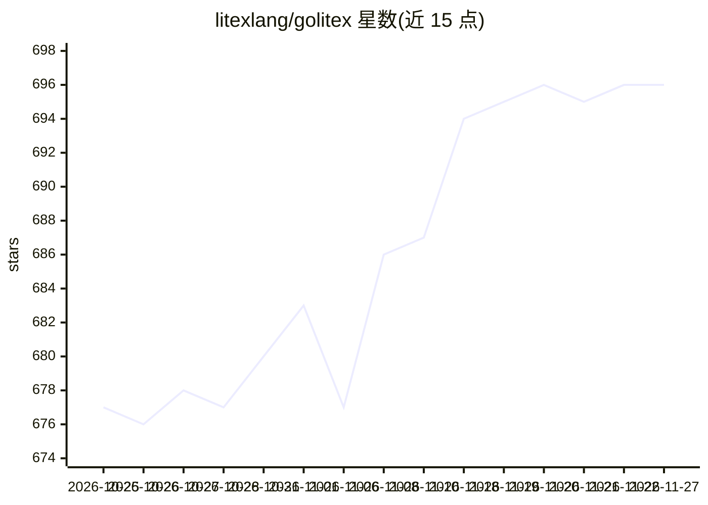

# litexlang/golitex

⭐ 696 · Rust · Apache-2.0 · 推送 2026-11-25 · [GitHub](https://github.com/litexlang/golitex) · [官网](https://litexlang.com) · 个人维护 · 中文 README

**面向形式化数学的高阶语言，供数学证明的书写与机器检查**

Litex 是一种用于书写数学对象、定义、命题与证明的形式化语言，语法接近日常数学写作。自带原生检查器验证定义域与证明步骤，被接受的命题可通过持久 Session 供后续命题引用。提供 brew/scoop 安装的 CLI，支持以 JSON 输出检查结果；附 Agent Guide 支持与 agent 协作写证明，并可将受支持的证明编译为 Lean 交由独立检查。项目处于活跃开发期，检查器的信任边界见手册说明。

## 筛选速览

| 维度 | 判定 | 备注 |
|---|---|---|
| AI 角色 | `ai-enhanced` | 去掉 AI 部分产品仍成立 |
| 许可风险 | `permissive` | Apache-2.0 |
| 部署形态 | `None` |  |
| 模型依赖 | — | README 未给出锁定关系 |
| 硬件要求 | — | 无带数字的原话,不猜 |
| 安装摩擦 | `low` | 无编译、无系统依赖或容器化 |
| 成熟度 | `idea` | |

## 能力要点

- 接近自然数学书写的形式化证明语言与原生检查器
- 持久 Session 支持基于已接受命题继续修正证明
- 可将受支持的证明编译到 Lean 进行独立检查
- brew/scoop 两种系统包管理器安装，CLI 输出 JSON

## 适用场景

- 以机器可检查的方式书写数学定义与证明
- 将证明编译为 Lean 做独立核验
- 借助 agent 辅助撰写形式化证明

## 场景标签

`科研工具` · 领域:学习与行业

## 证据(README 行号)

> L9: Litex lets you write mathematical objects, definitions, statements and proofs
> L53: |Write proofs with an agent|Agent Guide, primer|
> L59: Litex is under active development. The Lean backend compiles supported proof

## 星数曲线

2026-10-25 677 → 2026-11-27 696（+19）

---
*卡片 v1 · prompt 1.4 · 生成 2026-11-26 · 置信度 mid · 依据 README sha `1078b7af1de0` · [字段定义](../../DATASET.md)*
