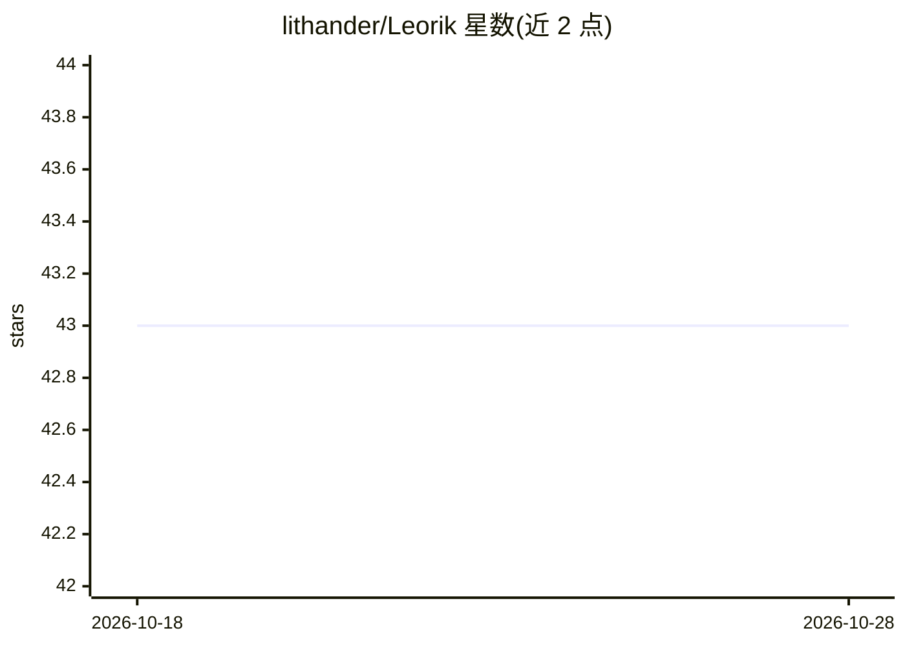

# lithander/Leorik

⭐ 43 · C# · MIT · 推送 2026-05-15 · [GitHub](https://github.com/lithander/Leorik) · 个人维护

**C# 编写的开源 UCI 国际象棋引擎，支持标准棋与Chess960**

UCI 协议国际象棋引擎，用 C# / .NET 编写，运行于外部棋类 GUI（Arena、BanksiaGUI、Cutechess、Nibbler、Chessbase 等）。搜索采用 Fail-hard Negamax、Alpha-Beta、PVS、Lazy SMP，局面评估使用 History corrected NNUE（768x5→640 隐层、5 输入桶 8 输出桶），网络经 60 亿标注局面训练。不提供自带界面，提供 Mac/Linux/Windows 预编译二进制，最新版 CCRL Blitz 3496 Elo。

## 筛选速览

| 维度 | 判定 | 备注 |
|---|---|---|
| AI 角色 | `ai-native` | 本体是模型或模型工具 |
| 许可风险 | `permissive` | MIT |
| 部署形态 | `None` |  |
| 模型依赖 | — | README 未给出锁定关系 |
| 硬件要求 | — | 无带数字的原话,不猜 |
| 安装摩擦 | `medium` | 含编译或系统依赖之一 |
| 成熟度 | — | 结构信号不足 |

## 能力要点

- NNUE 评估（768x5→640)x2→1x8 架构，同一网络支持 FRC 与标准棋
- Lazy SMP 并行搜索、MultiPV、Pondering
- 支持标准国际象棋与 Chess960 变体
- 提供 Mac/Linux/Windows 预编译二进制

## 适用场景

- 接入 UCI 兼容棋类 GUI 进行对局或分析
- Chess960 变体对弈
- 研究 NNUE 评估与搜索技术的 C# 实现

## 场景标签

 · 领域:游戏AI/棋类引擎

## 证据(README 行号)

> L12: * History corrected NNUE evaluation
> L101: **Leorik** does not provide its own user interface. Instead it implements the UCI protocol to make it compatible w

## 星数曲线

2026-10-18 43 → 2026-10-28 43（+0）

---
*卡片 v1 · prompt 1.4 · 生成 2026-10-25 · 置信度 high · 依据 README sha `b9da5a1a4ca6` · [字段定义](../../DATASET.md)*
