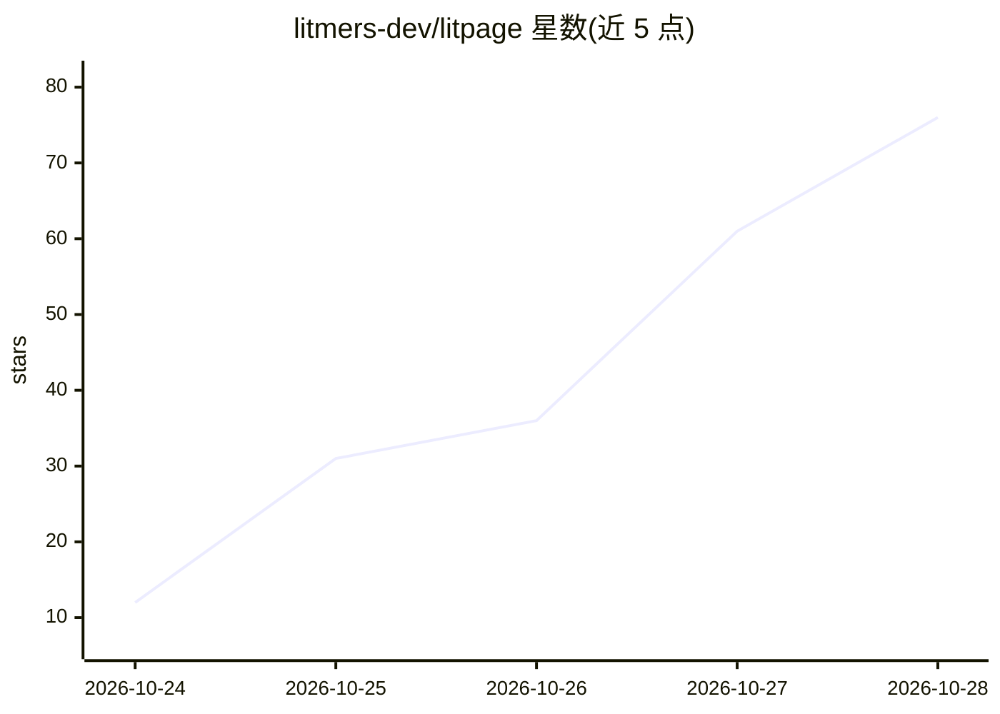

# litmers-dev/litpage

⭐ 76 · TypeScript · MIT · 推送 2026-10-26 · [GitHub](https://github.com/litmers-dev/litpage) · 组织维护 · 中文 README

**自托管工作台：块编辑器文档 + 数据库视图 + 可选 AI**

自托管的开源工作区应用，提供 41 种块类型的块编辑器、页面与团队管理、带十余种视图（表格/看板/时间线/图表等）的数据库、细粒度权限与实时多人协作。AI 为可选功能：聊天、自定义 agent、写作助手、数据库自动填充等，通过自备 OpenAI 或 Anthropic key 配置，无 key 时其余功能正常。整体为单 Node.js 进程 + 单 SQLite 文件，含 REST API、webhooks 与 MCP 端点。项目自述为由 AI coding agent 协作构建的研究演示项目。

## 筛选速览

| 维度 | 判定 | 备注 |
|---|---|---|
| AI 角色 | `ai-enhanced` | 去掉 AI 部分产品仍成立 |
| 许可风险 | `permissive` | MIT |
| 部署形态 | `self-host` | docker 或自建部署 |
| 模型依赖 | locked-api |  |
| 硬件要求 | — | 无带数字的原话,不猜 |
| 安装摩擦 | `low` | 无编译、无系统依赖或容器化 |
| 成熟度 | `idea` | |

## 能力要点

- 单 Node.js 进程 + SQLite 文件部署，无需 Postgres/Redis/队列
- 可选 AI：聊天、自定义 agent、写作助手、数据库自动填充（自备 OpenAI/Anthropic key）
- 数据库支持表格/看板/日历/时间线/图表等十余种视图与公式、自动化
- 提供 REST API、HMAC 签名 webhooks 与 MCP 端点

## 适用场景

- 自托管团队 wiki、项目文档与任务数据库
- 通过 AI key 启用对工作区内容的问答与写作辅助
- 让 AI 客户端通过 MCP 读写我有权限的页面

## 场景标签

`知识库管理` `AI 写作` · 领域:内容生成

## 证据(README 行号)

> L36: - **AI on your terms.** Chat, custom agents, AI blocks, autofill and meeting-note summaries run on the provider and
> L37:  you configure. Without a key, everything else works.

## 星数曲线

2026-10-24 12 → 2026-10-28 76（+64）

---
*卡片 v1 · prompt 1.4 · 生成 2026-10-25 · 置信度 mid · 依据 README sha `9a1de24e2846` · [字段定义](../../DATASET.md)*
