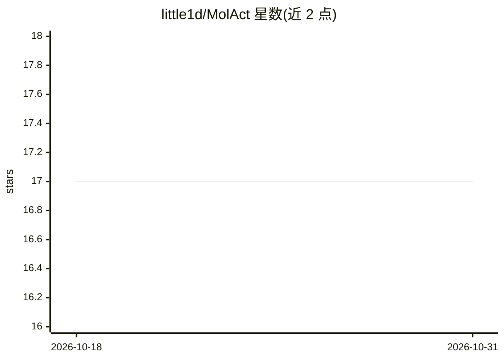

# little1d/MolAct

⭐ 17 · Python · 推送 2026-04-13 · [GitHub](https://github.com/little1d/MolAct) · [官网](https://arxiv.org/abs/2512.20135) · 组织维护

**训练 LLM 做分子编辑与性质优化的 Agentic RL 框架**

论文官方代码：通过多轮 Think-Tool-Observation 循环与 GRPO 算法，采用两阶段训练范式（先掌握基础编辑，再处理复杂性质优化）训练 LLM 自主调用化学工具完成分子设计，保证修改物理有效且性质优化。提供推理脚本、训练数据集与预训练模型（HuggingFace），在 ChemCoTBench 上评测分子编辑与优化任务；依赖 AgentFly 框架与 TDC 库，训练示例在 4 张 H200 上运行，仓库标注 Work in progress。

## 筛选速览

| 维度 | 判定 | 备注 |
|---|---|---|
| AI 角色 | `ai-ecosystem` | LLM/agent 周边工具 |
| 许可风险 | `none` | — |
| 部署形态 | `library` | 以包/库形式分发 |
| 模型依赖 | — | README 未给出锁定关系 |
| 硬件要求 | — | 无带数字的原话,不猜 |
| 安装摩擦 | `low` | 无编译、无系统依赖或容器化 |
| 成熟度 | `idea` | |

## 能力要点

- GRPO + 两阶段范式的 Agentic RL 训练
- 多轮 Think-Tool-Observation 循环调用化学工具
- 提供推理脚本、训练数据集与预训练模型
- 化学工具集：SMILES 校验、性质计算、官能团编辑、Murcko 骨架分析、Oracle 打分

## 适用场景

- 在 MolEdit/MolOpt 任务上运行预训练模型做分子编辑与优化推理
- 用 ChemCoTBench 评测分子编辑与优化结果
- 基于该框架复现或扩展 Agentic RL 分子设计训练

## 场景标签

`强化学习` `模型评测` · 领域:评测与运维

## 证据(README 行号)

> L6: MolAct is an Agentic RL framework that trains LLMs to design molecules through a multi-turn "Think-Tool-Observation"
> L131: The following shows an example of model training on molecular editing task using Qwen-2.5-7B as the base model on 

## 星数曲线

2026-10-18 17 → 2026-10-31 17（+0）

---
*卡片 v1 · prompt 1.4 · 生成 2026-10-29 · 置信度 mid · 依据 README sha `a7bfab0647cb` · [字段定义](../../DATASET.md)*
