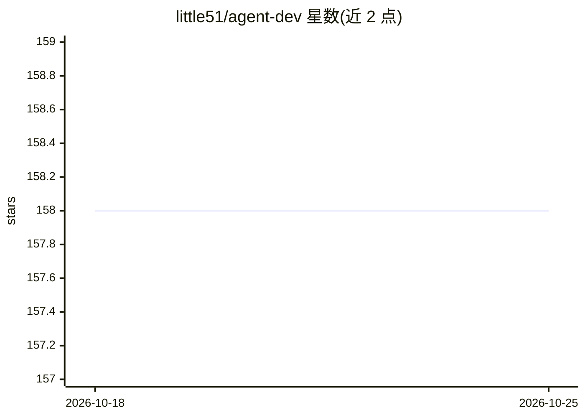

# little51/agent-dev

⭐ 158 · Python · 推送 2026-03-26 · [GitHub](https://github.com/little51/agent-dev) · [官网](https://aliendao.cn) · 个人维护 · 中文 README

**《大模型项目实战：Agent开发与应用》图书配套资源仓库**

一本 Agent 开发教材的配套资源仓库，按基础篇、应用篇、开发篇组织，列出 16 章的源代码与操作步骤索引。开发篇覆盖 GLM-4 Function-Calling、Agentscope ReActAgent、Langchain 任务驱动、LangGraph 工作流、Autogen 辅助编程、LlamaIndex 检索增强、crewAI 多角色、Qwen-Agent 图像与 CogVLM2 多模态应用等实例，并提供可在线体验的实例站点链接与勘误栏目。面向图书读者与 Agent 应用学习者。

## 筛选速览

| 维度 | 判定 | 备注 |
|---|---|---|
| AI 角色 | `ai-knowledge` | 知识聚合/清单类 |
| 许可风险 | `none` | — |
| 部署形态 | `None` |  |
| 模型依赖 | — | README 未给出锁定关系 |
| 硬件要求 | — | 无带数字的原话,不猜 |
| 安装摩擦 | `low` | 无编译、无系统依赖或容器化 |
| 成熟度 | — | 结构信号不足 |

## 能力要点

- 覆盖 16 章 Agent 开发实例的配套代码与步骤索引
- 涉及 Langchain、LangGraph、Autogen、LlamaIndex、crewAI 等多个框架
- 提供可在线体验的书中实例站点
- 包含出版社官方直营链接与勘误栏目

## 适用场景

- 随书学习 Agent 开发并获取各章源代码
- 按章节索引了解不同框架的 Agent 实例
- 在线体验书中示例应用

## 场景标签

`Agent 框架` `教程课程` · 领域:Agent 开发

## 证据(README 行号)

> L1: # 《大模型项目实战：Agent开发与应用》配套资源
> L3: ## 书中的源代码、操作步骤等配套资源

## 星数曲线

2026-10-18 158 → 2026-10-25 158（+0）

---
*卡片 v1 · prompt 1.4 · 生成 2026-10-22 · 置信度 high · 依据 README sha `b8b18e52d523` · [字段定义](../../DATASET.md)*
