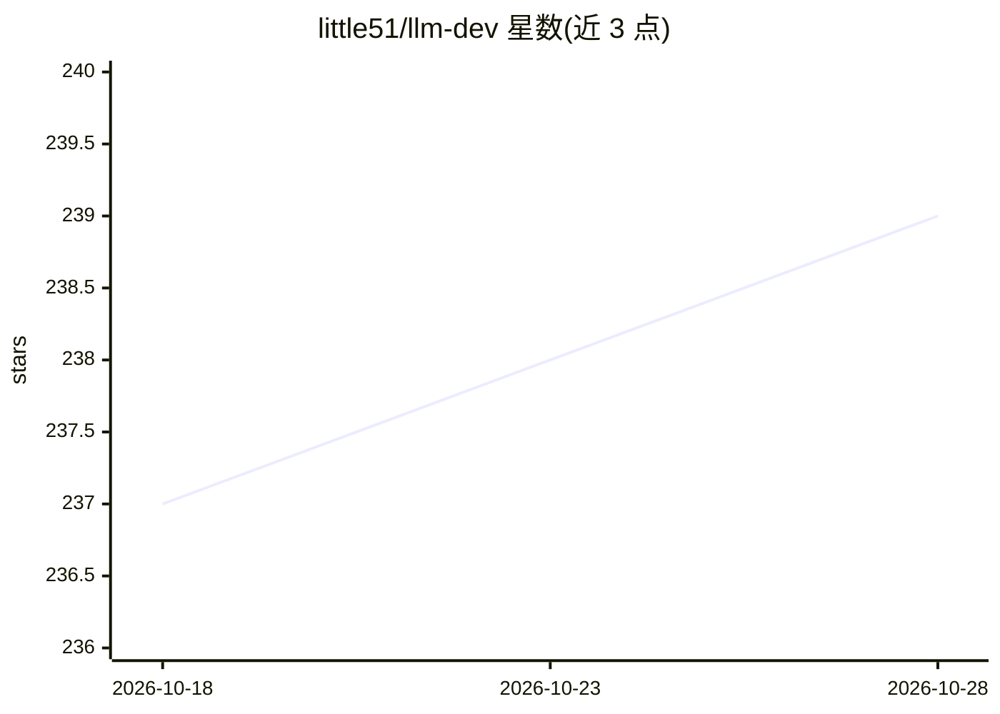

# little51/llm-dev

⭐ 239 · JavaScript · MIT · 推送 2026-03-14 · [GitHub](https://github.com/little51/llm-dev) · [官网](https://aliendao.cn) · 个人维护 · 中文 README

**《大模型项目实战》图书配套源代码与资源仓库**

图书《大模型项目实战：多领域智能应用开发》的配套资源仓库，按书章节组织源代码与操作步骤：基础篇涵盖大语言模型基础知识与应用架构，操作篇包含环境搭建、模型安装、微调、量化与多模态应用，开发篇覆盖 Chat 应用、RAG、翻译、智能代理、语音、数字人、AI 小镇等 18 章实践项目。README 提示依赖库版本升级可能导致运行问题，需关注勘误。另附作者其他资源链接。

## 筛选速览

| 维度 | 判定 | 备注 |
|---|---|---|
| AI 角色 | `ai-knowledge` | 知识聚合/清单类 |
| 许可风险 | `permissive` | MIT |
| 部署形态 | `None` |  |
| 模型依赖 | — | README 未给出锁定关系 |
| 硬件要求 | — | 无带数字的原话,不猜 |
| 安装摩擦 | `low` | 无编译、无系统依赖或容器化 |
| 成熟度 | — | 结构信号不足 |

## 能力要点

- 覆盖 18 章的图书配套源代码与操作步骤
- 操作篇包含模型安装、微调、量化、多模态
- 开发篇含 RAG、智能代理、语音、数字人、AI 小镇等项目

## 适用场景

- 随书学习大模型应用开发并运行书中代码
- 参考微调、量化、RAG 等多领域实践项目
- 查找作者提供的 github 加速与模型下载镜像资源

## 场景标签

`教程课程` `RAG` `微调` · 领域:知识与检索

## 证据(README 行号)

> L3: ## 书中的源代码、操作步骤等配套资源
> L15: ## 一、基础篇

## 星数曲线

2026-10-18 237 → 2026-10-28 239（+2）

---
*卡片 v1 · prompt 1.4 · 生成 2026-10-23 · 置信度 high · 依据 README sha `a429e32b3153` · [字段定义](../../DATASET.md)*
