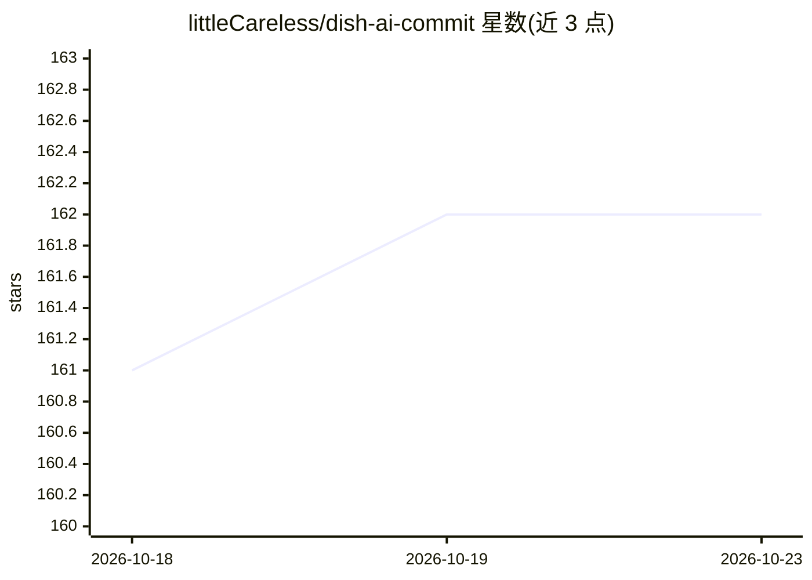

# littleCareless/dish-ai-commit

⭐ 162 · TypeScript · MIT · 推送 2026-09-23 · [GitHub](https://github.com/littleCareless/dish-ai-commit) · [官网](https://554659.me/dish-commit-docs) · 个人维护 · 中文 README

**面向开发者的 VSCode 扩展：AI 生成标准化 Git/SVN 提交信息**

VSCode 扩展，读取代码变更生成符合 Conventional Commits 规范的 Git/SVN 提交信息，支持 20+ AI 提供商（OpenAI、Ollama、GitHub Copilot、智谱、DashScope、豆包、DeepSeek、Gemini、Claude、Mistral 等），含免费额度与本地部署选项。附加功能：PR 摘要生成、分支命名、周报生成、AI 辅助代码评审、交互式聊天界面。基于 tree-sitter 与 Qdrant 向量数据库做语义代码索引（30+ 语言），embedding 支持 OpenAI/Ollama 及兼容服务。提交信息支持 19 种语言输出与自动 emoji 匹配，可通过配置关闭正文或合并多文件变更。

## 筛选速览

| 维度 | 判定 | 备注 |
|---|---|---|
| AI 角色 | `ai-native` | 本体是模型或模型工具 |
| 许可风险 | `permissive` | MIT |
| 部署形态 | `desktop` | 安装包/桌面程序 |
| 模型依赖 | local-ok | 支持本地模型 |
| 硬件要求 | — | 无带数字的原话,不猜 |
| 安装摩擦 | `low` | 无编译、无系统依赖或容器化 |
| 成熟度 | — | 结构信号不足 |

## 能力要点

- 支持 20+ AI 提供商，含免费额度与 Ollama 本地部署
- tree-sitter + Qdrant 语义代码索引，增量更新仅处理变更文件
- 生成符合 Conventional Commits 规范的提交信息并自动匹配 emoji
- 附加 PR 摘要、分支命名、周报生成与 AI 代码评审功能

## 适用场景

- 写提交信息时让 AI 根据代码变更自动生成规范 commit message
- 团队统一提交信息格式并生成周报与 PR 描述
- 数据敏感场景下用 Ollama 本地模型生成提交信息

## 场景标签

`代码审查` · 领域:编码与开发

## 证据(README 行号)

> L3: A powerful VSCode extension that uses AI technology to generate standardized Git/SVN commit messages. Supports multi
> L35: - **20+ AI Providers**: OpenAI, Ollama, GitHub Copilot, Zhipu AI, DashScope, Gemini, Anthropic Claude, Mistral AI, 

## 星数曲线

2026-10-18 161 → 2026-10-23 162（+1）

---
*卡片 v1 · prompt 1.4 · 生成 2026-10-22 · 置信度 high · 依据 README sha `dfb25380fca9` · [字段定义](../../DATASET.md)*
