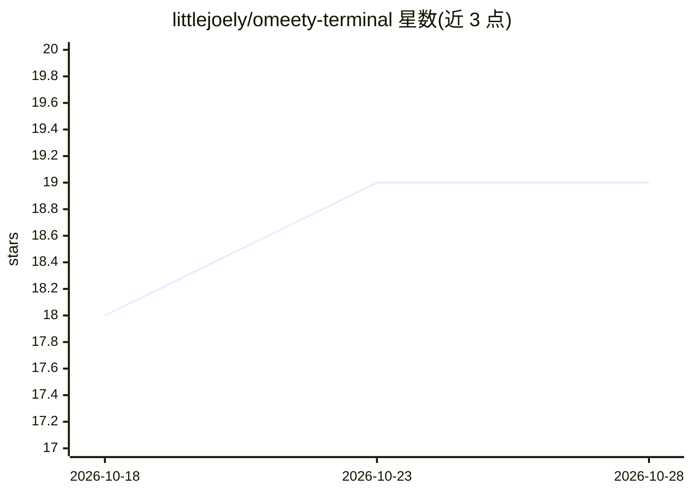

# littlejoely/omeety-terminal

⭐ 19 · JavaScript · MIT · 推送 2026-08-22 · [GitHub](https://github.com/littlejoely/omeety-terminal) · 个人维护 · 中文 README

**浏览器侧栏本地终端扩展：为 MCP CLI Agent 提供 41 个浏览器工具**

Chrome/Edge 侧栏扩展，内嵌基于 xterm.js 与真实 PTY（Windows ConPTY、macOS zsh）的本地终端，通过 Native Messaging 与 Browser Core v2 向 Codex、Claude Code、Kimi Code 等支持 MCP 的 CLI Agent 提供 41 个本地 MCP 工具：读取当前标签页、点击输入、文件上传、截图与下载等，操作用户已登录的标签页。高风险动作保留用户确认，MCP 服务仅监听 127.0.0.1，审计记录做脱敏处理。需安装 Node.js LTS，经安装脚本配置 Native Host 并改写 Agent 配置（带备份）。

## 筛选速览

| 维度 | 判定 | 备注 |
|---|---|---|
| AI 角色 | `ai-ecosystem` | LLM/agent 周边工具 |
| 许可风险 | `permissive` | MIT |
| 部署形态 | `None` |  |
| 模型依赖 | — | README 未给出锁定关系 |
| 硬件要求 | — | 无带数字的原话,不猜 |
| 安装摩擦 | `low` | 无编译、无系统依赖或容器化 |
| 成熟度 | `idea` | |

## 能力要点

- 41 个 MCP 工具（Browser Core 7 个高层工具 + 底层工具 + 3 个下载工具）
- 侧栏内真实本地 PTY，可直接运行 git/npm/codex/claude/kimi 等命令
- 操作用户已登录的当前标签页，高风险动作（提交/删除/非 GET）保留确认
- MCP 服务仅监听 127.0.0.1，支持 read/act/submit 权限分级与脱敏审计

## 适用场景

- 让终端里的 CLI Agent 看见并操作我已登录的网页（填表、审批、后台配置）
- 跨系统流程：从网站导出数据、处理后再上传到另一系统
- 网页与本地联动：把页面内容保存为文件再填回网页

## 场景标签

`浏览器自动化` · 领域:效率与自动化

## 证据(README 行号)

> L11: **Omeety Terminal 把真实本地终端放进 Chrome / Edge 侧栏，让你已经在用的
> L37: - **不绑定模型**：浏览器能力通过 MCP 提供，支持 MCP 的 CLI Agent 可以复用同一套工具。
> L119: Browser Core 提供 7 个高层工具以及兼容的底层浏览器工具；另有 3 个持久化下载工具，

## 星数曲线

2026-10-18 18 → 2026-10-28 19（+1）

---
*卡片 v1 · prompt 1.4 · 生成 2026-10-28 · 置信度 high · 依据 README sha `a9941158c89f` · [字段定义](../../DATASET.md)*
