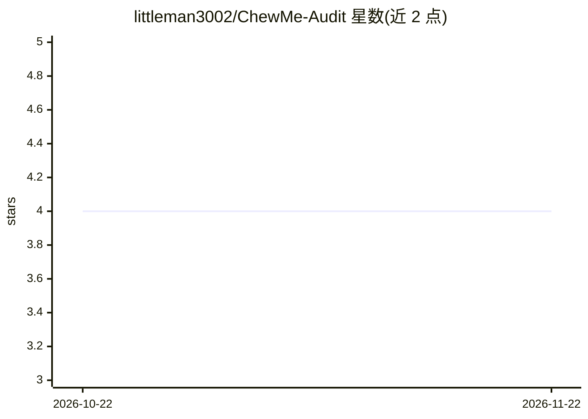

# littleman3002/ChewMe-Audit

⭐ 4 · Python · MIT · 推送 2026-10-30 · [GitHub](https://github.com/littleman3002/ChewMe-Audit) · 个人维护

**审计 AI agent 轨迹中被浪费的 token 并折算成美元的 CLI**

读取 agent 轨迹导出（JSONL、Langfuse、LangSmith、Claude Code、LiteLLM 格式），检测重复工具调用、近似重复重发、超长工具输出、死上下文等浪费模式，按 provider 单价折算美元成本并给出可粘贴的修复片段；支持 --diff 对比修复前后差异，--receipt 生成 SHA-256 防篡改回执，另含盲写风险检查。本地计数 token，无需 API key；未接 API 日志时所有金额标注为估算。以 pip 包形式安装，MIT 许可。

## 筛选速览

| 维度 | 判定 | 备注 |
|---|---|---|
| AI 角色 | `ai-ecosystem` | LLM/agent 周边工具 |
| 许可风险 | `permissive` | MIT |
| 部署形态 | `library` | 以包/库形式分发 |
| 模型依赖 | — | README 未给出锁定关系 |
| 硬件要求 | — | 无带数字的原话,不猜 |
| 安装摩擦 | `low` | 无编译、无系统依赖或容器化 |
| 成熟度 | — | 结构信号不足 |

## 能力要点

- 检测 5 类浪费模式：重复调用、近似重发、超长输出、pretty-print JSON、死上下文
- 按 provider 记录单价的每百万 token 成本折算，--pricing 可覆盖
- --diff 模式证明修复前后的 delta，跨检测器去重不重复计数
- --api-log 接入 provider 日志时缓存核算标注为 measured

## 适用场景

- 审计 agent 轨迹找出错误循环等浪费并折算美元成本
- 对比修复前后轨迹证明优化效果
- 配合 Langfuse/LangSmith/Claude Code 导出做 token 成本分析
- 检查 agent 写文件前是否充分读取（盲写风险）

## 场景标签

`LLM 可观测性` · 领域:评测与运维

## 证据(README 行号)

> L3: A CLI that reads your agent traces and tells you where the money went —
> L9: ## Install
> L229: - **Headline:** measurable waste in tokens and dollars, share of input

## 星数曲线

2026-10-22 4 → 2026-11-22 4（+0）

---
*卡片 v1 · prompt 1.4 · 生成 2026-11-21 · 置信度 high · 依据 README sha `fd7545797f6f` · [字段定义](../../DATASET.md)*
