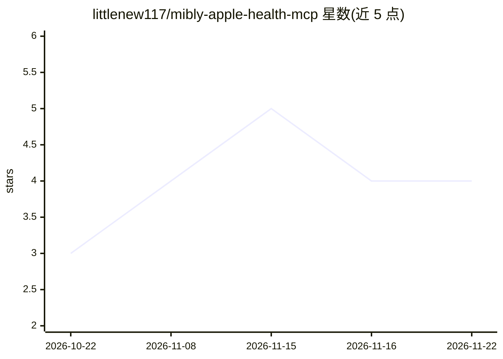

# littlenew117/mibly-apple-health-mcp

⭐ 4 · TypeScript · MIT · 推送 2026-11-19 · [GitHub](https://github.com/littlenew117/mibly-apple-health-mcp) · [官网](https://mibly.app) · 个人维护

**让 AI Agent 通过 MCP 读取本地 Apple Health 健康数据的接收器**

开源的 Apple Health MCP server 接收端：iPhone 上的 Mibly 应用负责 HealthKit 读取、权限与后台同步，本仓库的接收器在用户自有机器上监听并加密存储数据（AES-256-GCM，仅本地文件，无出站请求），并通过 HTTP 提供 MCP 接口（含 stdio 模式），供 Claude、Codex、Cursor 等任意 MCP 客户端查询睡眠、步数、心率、HRV、锻炼等数据。需 Node.js 18+，提供 launchd/systemd 开机自启配置。本地模式免费，跨设备远程访问需 Mibly Pro 云服务。

## 筛选速览

| 维度 | 判定 | 备注 |
|---|---|---|
| AI 角色 | `ai-ecosystem` | LLM/agent 周边工具 |
| 许可风险 | `permissive` | MIT |
| 部署形态 | `None` |  |
| 模型依赖 | — | README 未给出锁定关系 |
| 硬件要求 | — | 无带数字的原话,不猜 |
| 安装摩擦 | `low` | 无编译、无系统依赖或容器化 |
| 成熟度 | — | 结构信号不足 |

## 能力要点

- 本地模式：数据加密存储于用户机器，无账户、无遥测、无出站请求
- 通过 MCP HTTP 或 stdio 接口向任意 MCP 客户端提供健康数据工具
- 配对 token 鉴权，所有路由要求 Bearer 认证
- 提供 macOS launchd 与 Linux systemd 开机自启配置

## 适用场景

- 让 Claude Code 等 coding agent 查询我的睡眠、心率、锻炼数据
- 自托管方式把 Apple Health 数据留在自己机器上供 agent 使用
- 局域网内 iPhone 与自有服务器配对同步健康样本

## 场景标签

 · 领域:健康数据/量化自我与 AI Agent 接入

## 证据(README 行号)

> L17: An open-source **Apple Health MCP server** for your Personal Agent: bring your Apple Health (HealthKit) data — slee
> L78: Connect an MCP client over HTTP to `http://<ip>:7345/mcp` with the header `Authorization: Bearer <token>`. For agen

## 星数曲线

2026-10-22 3 → 2026-11-22 4（+1）

---
*卡片 v1 · prompt 1.4 · 生成 2026-11-21 · 置信度 high · 依据 README sha `3e5b437a0078` · [字段定义](../../DATASET.md)*
