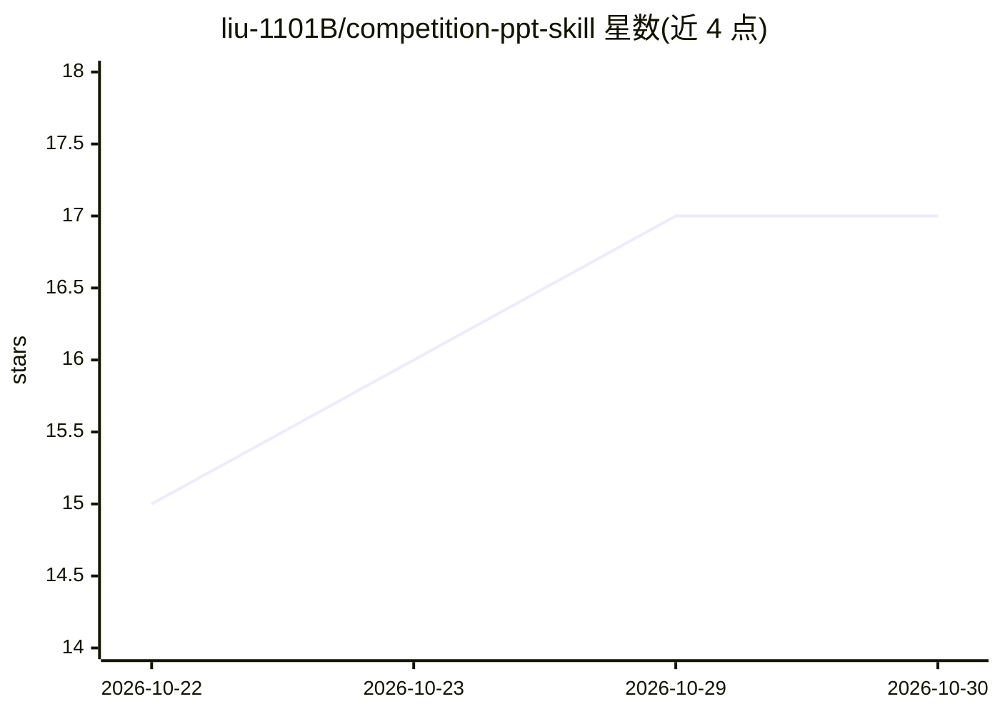

# liu-1101B/competition-ppt-skill

⭐ 17 · Python · MIT · 推送 2026-10-24 · [GitHub](https://github.com/liu-1101B/competition-ppt-skill) · 个人维护 · 中文 README

**给 AI Agent 的国赛路演 PPT 生成方法论与脚本**

面向中国国际大学生创新大赛的 SKILL.md 方法论包：由方法论文档（页序、Section 标签体系、副标题句式、评分映射）加两个 Python 脚本组成，用 python-pptx 与 PIL 生成 30-45 页原创版式 PPT，背景全部程序化绘制不引入第三方素材。需交给具备文件读写与执行 Python 能力的 Agent（如 Claude Cowork）运行。限制：随仓库的 build-ppt.py 是特定项目 20 页示例脚本，非通用生成引擎；不联网、不调 API。

## 筛选速览

| 维度 | 判定 | 备注 |
|---|---|---|
| AI 角色 | `ai-ecosystem` | LLM/agent 周边工具 |
| 许可风险 | `permissive` | MIT |
| 部署形态 | `library` | 以包/库形式分发 |
| 模型依赖 | — | README 未给出锁定关系 |
| 硬件要求 | — | 无带数字的原话,不猜 |
| 安装摩擦 | `low` | 无编译、无系统依赖或容器化 |
| 成熟度 | `idea` | |

## 能力要点

- SKILL.md 方法论：8 步流程 + 页面文案模板 + 评分维度到页数的映射
- python-pptx + PIL 程序化生成背景与版式，不使用第三方素材
- 纯本地运行，不需要联网或调用 API
- 兼容 Claude 类 skills 规范的 Agent 环境

## 适用场景

- 让 Agent 按国赛评分维度生成 30-45 页路演 PPT
- 参考方法论拆解路演模板的页序与设计语言
- 改评分映射后复用到其他比赛的 PPT 制作

## 场景标签

`AI 写作` · 领域:内容生成

## 证据(README 行号)

> L19: 一份 `SKILL.md`（方法论）+ 两个脚本（生图 / 出稿），交给具备文件读写能力的 Agent 执行。
> L64: 1. 把 `SKILL.md` 放进 Agent 的 skills 目录（Claude Cowork / 其他兼容 skills 规范的环境）。

## 星数曲线

2026-10-22 15 → 2026-10-30 17（+2）

---
*卡片 v1 · prompt 1.4 · 生成 2026-10-29 · 置信度 high · 依据 README sha `e27198b874d4` · [字段定义](../../DATASET.md)*
